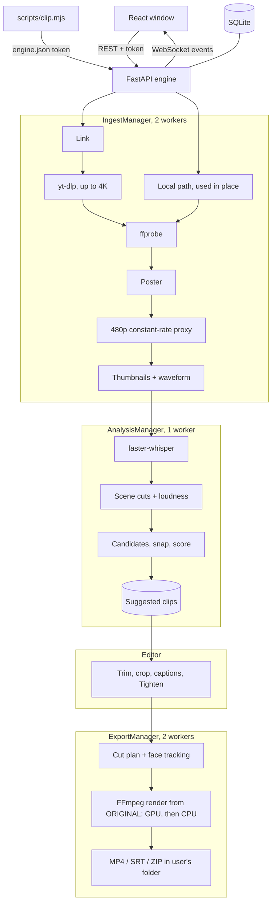

# Smart Clips ("Clipping App") source audit

Audit date: 2026-11-23. Scope: the full source tree at `e:\Projects-Products\smart clips`. No source file was modified.

**How to read the evidence.** Each finding carries one of these tags:

- **Reproduced**: I ran the project's own code, copied to a scratch folder with the pinned dependencies, and saw the failure.
- **By reading**: the code path is unambiguous, but I did not run it.
- **Needs verification**: something outside the code decides it. The finding says what would settle it.

No FFmpeg binary was available, so nothing was rendered end to end (see section 7). Filter-graph findings were reproduced by running the app's generated expressions through libavfilter (PyAV, already a dependency).

---

## 1. Executive summary

The codebase is in good overall shape. Subprocesses use argument lists with no shell, paths are built from integer ids, the API has a per-launch token, SQL is parameterized, cuts are re-encoded to exact frames, and the Electron window is sandboxed. I found no Critical issue, no command injection, no path traversal and no hardcoded secret.

The problems are mostly correctness and lifecycle bugs that produce **wrong output without an error**: 5 High, 20 Medium, 17 Low and 4 Info.

Top three risks:

1. **Wrong output in Tighten and captions.** Tightening a variable-frame-rate video desynchronizes sound by seconds (F-02). Editing a caption on a tightened clip changes the wrong words (F-03).
2. **Reused database ids cross-contaminate jobs.** Deleting a running import or export and adding another lets the old job write its failure onto the new one and share its folder (F-04).
3. **Transcription fails on NVIDIA PCs without the CUDA 12 libraries.** The CPU fallback never triggers (F-01). Auto clipping, captions and Tighten all depend on it.

Before distributing the app more widely, also address the unsigned, auto-installing update channel (F-05) and GPL redistribution (F-23).

---

## 2. Architecture and pipeline overview

| Aspect | What it is |
|---|---|
| Product | Single-user, local Windows desktop app. No cloud service, no LLM, no accounts, no multi-tenancy |
| UI | Electron 45, React 19, TypeScript, Zustand, Tailwind 4 (`apps/desktop`) |
| Engine | Python 3.11+, FastAPI/uvicorn on `127.0.0.1:<random>`, SQLite in WAL mode (`engine/`) |
| Media and ML | FFmpeg/ffprobe (bundled), yt-dlp, faster-whisper (CTranslate2), OpenCV YuNet |
| Entry points | `apps/desktop/src/main/index.ts`, `engine/run.py`, `scripts/clip.mjs` (agent CLI) |
| Auth | Random 32-byte token per launch, sent as the `x-engine-token` header, or `?token=` for `/media/` and `/ws` |
| Deployment | PyInstaller engine plus electron-builder NSIS installer; updates from GitHub Releases |
| External calls | Video sites (yt-dlp), Hugging Face (speech models), GitHub (updates) |
| Queues | In-process `ThreadPoolExecutor`s: import 2, timeline backfill 1, export 2, analysis 1 |

Clip selection is rule-based scoring (`analysis/scoring.py`), not a model. The questions about parsing model output, prompt injection through transcripts and API cost therefore do not apply. Whisper's output is used only as text and timings.



Storage: `%APPDATA%\Clipping App\data\clipping.db` and `projects/<project>/sources/<source>/`, holding the proxy, poster, thumbnails, waveform, transcript, scenes, loudness, and the download for links. Delivery is a file in a folder the user picks.

---

## 3. Findings table

Paths are relative to the repository root. `E/` = `engine/app/`, `D/` = `apps/desktop/src/`.

| ID | Severity | Confidence | Area | Location | Summary |
|---|---|---|---|---|---|
| F-01 | High | High | Correctness | `E/analysis/transcribe.py:49-54` | CUDA fallback never triggers; transcription fails on NVIDIA PCs without CUDA 12 |
| F-02 | High | High | Correctness | `E/media/render.py:209` | Tighten on variable-frame-rate video desyncs sound by seconds |
| F-03 | High | High | Correctness | `E/api/captions.py:96-101` | Caption edits hit the wrong words when Tighten is on |
| F-04 | High | High | Reliability | `E/db.py:20,36,67` | Reused ids let a deleted job overwrite a new one |
| F-05 | High | Medium | Security | `D/main/updater.ts:35-36` | Unsigned builds auto-install from GitHub |
| F-06 | Medium | High | Security | `E/main.py:52,71` | No token plus CORS `null`: any website can drive a standalone engine |
| F-07 | Medium | High | Correctness | `E/media/download.py:92,111` | Playlist or multi-video links download everything, then fail |
| F-08 | Medium | High | Correctness | `E/exports.py:402` | Tighten ignored when only one segment remains |
| F-09 | Medium | High | Correctness | `E/captions/service.py:98-101` | First and last captions cannot be deleted |
| F-10 | Medium | High | Correctness | `E/captions/service.py:97` | Caption edits outside a trimmed range are lost |
| F-11 | Medium | High | Correctness | `E/api/exports.py:79-83` | First export's default framing sticks forever |
| F-12 | Medium | High | Correctness | `E/media/render.py:207,211` | Tighten audio cut on packet boundaries; A/V drift builds up |
| F-13 | Medium | High | Correctness | `E/edit/cutplan.py:13` | English filler list cuts real words in other languages |
| F-14 | Medium | Medium | Reliability | `D/main/engine.ts:190-195` | Quit/restart kills the engine only; FFmpeg is orphaned on Windows |
| F-15 | Medium | High | Reliability | `E/media/transcode.py:46-52` | Exception in progress callback leaves FFmpeg running |
| F-16 | Medium | High | Reliability | `E/exports.py:260-264,427` | ZIP never created, or incomplete, after cancel/retry |
| F-17 | Medium | High | Reliability | `E/db.py:184-186` | Migrations not atomic; an interrupted one blocks startup |
| F-18 | Medium | High | Reliability | `E/analysis/signals.py:57,87,110` | Failed scene/loudness runs are cached permanently |
| F-19 | Medium | Medium | Reliability | `D/renderer/src/lib/api.ts:466-477` | Event WebSocket never reconnects |
| F-20 | Medium | High | Reliability | `E/api/captions.py:74`, `E/captions/styles.py:78` | One bad style value makes the project unopenable |
| F-21 | Medium | High | Performance | `E/analysis/scoring.py:74` | Scoring is quadratic: about 54 s for 3 h of talk, minutes with wide limits |
| F-22 | Medium | High | Performance | `E/analysis/transcribe.py:30-37` | Whole audio track held in memory, several copies |
| F-23 | Medium | Medium | Licensing | `apps/desktop/electron-builder.yml:13-20` | GPL FFmpeg and x264/x265 shipped without licenses or source offer |
| F-24 | Medium | Medium | Dependencies | `apps/desktop/package.json` | Electron 45.0.0 is behind 45.4.1 |
| F-25 | Medium | Medium | Correctness | `E/media/render.py:134` | HDR sources reduced to 8-bit with no tone mapping |
| F-26 | Low | High | Security | `E/api/sources.py:25-30` | Link import reaches internal hosts and follows redirects |
| F-27 | Low | High | Security | `D/main/index.ts:36-39` | No navigation guard; any page in the window gets the bridge |
| F-28 | Low | High | Dependencies | `engine/requirements.txt` | Transitive Python packages, FFmpeg and models not pinned or hashed |
| F-29 | Low | High | Performance | `E/reframe/service.py:67,129` | Face tracking and audio decoding repeated per size |
| F-30 | Low | High | Reliability | `E/media/download.py:88-100` | No download size/disk limit; partial downloads kept |
| F-31 | Low | High | Reliability | `E/exports.py:313,371,443` | Leaked temp folder and ZIP; existing `.srt` overwritten |
| F-32 | Low | High | Reliability | `E/ingest.py:74-79`, `E/api/sources.py:95-104` | Queued cancels look ignored; retry and suggestion races |
| F-33 | Low | High | Correctness | `E/api/analysis.py:51-53` | Analysis range beyond the video accepted, finds nothing |
| F-34 | Low | High | Correctness | `E/analysis/candidates.py:106-118` | "Even split" produces overlapping clips |
| F-35 | Low | High | Correctness | `E/analysis/finder.py:64` | "Replace clip" runs out early |
| F-36 | Low | High | Correctness | `D/renderer/src/components/editor/EditorView.tsx:255,327` | Nudges drift off frames; undo loses the follow mode |
| F-37 | Low | High | Correctness | `E/analysis/candidates.py:10`, `E/analysis/scoring.py:56` | Non-Latin sentence ends and symbol keywords never match |
| F-38 | Low | Medium | Correctness | `E/media/transcode.py:93` | Proxy may use cover art; frame mapping wrong above 60 fps |
| F-39 | Low | High | Reliability | `D/main/engine.ts:142-147,169` | Stale startup timer; timeout shown as "stopped" |
| F-40 | Low | High | Quality | `scripts/clip.mjs:59-74,166-180` | CLI flags swallow ids; waiting crashes on missing jobs |
| F-41 | Low | High | Observability | `E/exports.py:378`, `E/ingest.py:236` | Media failures never logged |
| F-42 | Low | High | Quality | various | No CI or lint, no UI tests, dead columns, duplicated rules |
| F-43 | Info | Low | Security | `E/media/probe.py:90` | FFmpeg input protocols not restricted |
| F-44 | Info | High | Security | `E/main.py:52` | Non-ASCII token gives 500 instead of 401 |
| F-45 | Info | High | Dependencies | `package-lock.json` | One advisory, in build-only `minimatch` |
| F-46 | Info | High | Licensing | `E/media/download.py` | Site terms-of-service exposure from downloads |

---

## 4. Detailed findings

### High

#### F-01: The GPU fallback never triggers, so transcription fails on many NVIDIA PCs
**High, confidence High. Reproduced (failure point). `engine/app/analysis/transcribe.py:49-54`**

```python
if ctranslate2.get_cuda_device_count() > 0:
    try:
        return WhisperModel(name, device="cuda", compute_type="float16", download_root=str(models_dir))
    except Exception:
        pass  # fall back to CPU, e.g. when CUDA libraries are missing
```

**What's wrong.** CTranslate2 loads `cublas64_12.dll` when inference starts, not when the model is constructed. The `try` covers only construction. The wheel bundles `cudnn64_9.dll` but not cuBLAS, and an ordinary NVIDIA driver does not install it.

**Evidence.** On this machine (RTX 5060, current driver), using a tiny random-weight Whisper model on `device="cuda"`:
```
constructor on cuda: OK
encode failed: RuntimeError Library cublas64_12.dll is not found or cannot be loaded
```

**Scenario.** A user with a gaming GPU and no CUDA toolkit clicks "Find clips". It fails with "Unexpected error: Library cublas64_12.dll is not found…". Captions and Tighten fail too, and the app offers no CPU option.

**Fix.** Test inference inside the `try`, and fall back on failure:
```python
model = WhisperModel(name, device="cuda", compute_type="float16", download_root=str(models_dir))
segments, _ = model.transcribe(np.zeros(SAMPLE_RATE, dtype=np.float32), language="en")
list(segments)          # forces encode/decode now, while we can still fall back
return model
```
Log the exception instead of `pass`. Alternatively, bundle the CUDA libraries.

#### F-02: Tightening a variable-frame-rate video desynchronizes picture and sound
**High, confidence High. Reproduced. `engine/app/media/render.py:209` (graph order at `:246`)**

```python
graph = f"[0:v]select='{'+'.join(video_terms)}',setpts=N/({rate.numerator}/{rate.denominator})/TB[vsel]"
```

**What's wrong.** Frames are renumbered as if they arrived at the average rate. For a VFR source that is false. The `fps=` filter that would fix the timing comes *after* `select`/`setpts`. Audio is cut by real time, so the two diverge. `is_vfr` is detected, but only used for a badge.

**Evidence.** The app's own graph on a source with 10 s at 60 fps then 10 s at 5 fps, and one 0.6 s cut:
```
frame from source t=10.0 plays at 17.35 s; its sound plays at 9.4 s
frame from source t=15.0 plays at 18.12 s; its sound plays at 14.4 s
```
This is a deliberately strong case; phone footage with small rate changes drifts less. A constant-rate control was correct.

**Scenario.** The user imports a screen recording, enables "Remove pauses" and exports. The video is badly out of sync, yet the job says Done.

**Fix.** Make the rate constant before selecting:
```python
graph = f"[0:v]fps={fps},select='…',setpts=N/({rate.numerator}/{rate.denominator})/TB[vsel]"
```
Recheck the half-frame margins afterwards, because `fps` re-times frames. Add a VFR test.

#### F-03: Editing a caption on a tightened clip changes the wrong words
**High, confidence High. Reproduced. `engine/app/api/captions.py:96-101`, `engine/app/captions/service.py:108-112`**

```python
# service.py: what the editor is shown
words = _without_cut_words(conn, settings, clip, words)   # fillers removed
return make_cues(words, style, ...)                        # index = position in the FILTERED list

# api/captions.py: what an edit is applied to
words, _ = clip_words(conn, request.app.state.settings, clip)   # UNFILTERED list
updated = apply_text_edit(words, body.indices, body.text)
```

**What's wrong.** Indices come from one list and are applied to a longer one. Every removed filler before a cue shifts the edit by one word. The bounds check still passes.

**Evidence.** Words: "Um, hello there friend. …", with Tighten on:
```
user edits "hello there friend." (indices [0,1,2]) to "HELLO there friend."
result: ['there friend.', 'friend.', 'Second line.', 'Last words.']
```

**Scenario.** The user fixes a typo. The caption loses words or duplicates them, and the result is saved and burned into the export.

**Fix.** Assign a stable `index` to words *before* filtering, and make `make_cues` preserve it. With gaps now possible, replace the contiguity check at `:99` with an explicit index set.

#### F-04: Reused database ids let a deleted job overwrite a new one
**High, confidence High. Reproduced. `engine/app/db.py:20,36,67`, `engine/app/ingest.py:163-168,232-247`, `engine/app/exports.py:260-264`**

```sql
CREATE TABLE sources ( id INTEGER PRIMARY KEY, ...   -- no AUTOINCREMENT: SQLite reuses the highest id
```
```python
if row is None or token.cancelled:
    if row is not None:
        self._update(job_id, status="cancelled", error=None)   # may be a different job by now
```

**What's wrong.** Workers, cancel tokens, locks and the source's folder are keyed by id. After the newest row is deleted, the next insert gets the same id while the old worker may still be running. The UI guards its undo stack against this (`store.ts:49-53`), but the engine does not.

**Evidence.**
```
deleted source 3, new source 3 | same work dir: True
write to the NEW source row by the OLD worker: ('failed', 'OLD VIDEO ERROR')
deleted clip 8 job 8 | new clip 8 job 8
stale cancelled job pops -> new job now 'cancelled'
```
(For the export case I invoked the stale queued job's worker function directly.)

**Scenario.** The user pastes the wrong link, deletes it and pastes the right one. The old worker marks the new import cancelled or failed, and both write `original.*` and `proxy.partial.mp4` in one folder. For exports, a job wrongly seen as "cancelled" can be left out of its ZIP. If the user presses Retry, the clip renders twice.

**Fix.** Use `AUTOINCREMENT` for `sources`, `clips`, `clip_formats` and `export_jobs`. This needs a table rebuild in a new migration. As an immediate guard, have each worker write only while it still owns the token:
```python
if self.tokens.get(source_id) is not token:
    return None
```
Alternatively, key folders and tokens by a UUID.

#### F-05: Unsigned builds update themselves automatically from GitHub
**High, confidence Medium (the installer was not built). By reading. `apps/desktop/src/main/updater.ts:35-36`, `apps/desktop/electron-builder.yml:36-41`, `README.md:84-86`**

```ts
autoUpdater.autoDownload = true
autoUpdater.autoInstallOnAppQuit = true
```
```yaml
publish: { provider: github, owner: YeaminRabbi, repo: clipping-app, releaseType: release }
```

**What's wrong.** The README says the installer is not code-signed. On Windows, electron-updater checks the publisher only when the build carries a publisher name from a signing certificate. Without one, the only check is a hash in `latest.yml`, from the same GitHub release as the installer.

**Scenario.** Anyone who gains write access to that repository, or to the `repo`-scope token used for releases, can publish a version that is installed on every user's PC when they quit the app.

**Fix.** Sign builds before enabling automatic installation. Until then set `autoInstallOnAppQuit = false` and `autoDownload = false`, and ask first. Release with a fine-grained, short-lived token restricted to one repository, from CI. Confirm that the account named in the config is the intended publisher.

### Medium

#### F-06: A standalone engine can be driven by any website
**Medium (High impact, developer mode only), confidence High. Reproduced. `engine/app/main.py:52,71`, `engine/app/config.py:39-40`, `engine/run.py:40-41`**

```python
return settings.token is None or (supplied is not None and secrets.compare_digest(supplied, settings.token))
allow_origin_regex=r"^(http://(localhost|127\.0\.0\.1):\d+|file://.*|null)$"
```

**What's wrong.** With no token (the documented `run.py --port 8765` and `make engine` mode) there is no authentication, the port is fixed, and CORS accepts the `null` origin, which any site can produce with a sandboxed iframe. The `Host` header is not checked, and `--host 0.0.0.0` is also accepted without a token.

**Evidence.** The preflight with `Origin: null` was allowed. A cross-origin `POST /projects` with a foreign `Host` returned 201. Importing an arbitrary local path returned 201. A missing path returned 422, which reveals whether a file exists.

**Scenario.** While the engine runs on its own, a web page can import a private video by path, read it back via `/media/...`, write exports to chosen folders, or delete projects. Newer browsers may prompt for local-network access, which reduces but does not remove this.

**Fix.** Always require a token: if none is set, generate one and print it. Remove `null` unless the packaged renderer needs it (check its actual origin first). Add `TrustedHostMiddleware(allowed_hosts=["127.0.0.1", "localhost"])`. Refuse a non-loopback `--host` without a token.

#### F-07: Playlist and multi-video links download everything, then fail
**Medium, confidence High. Reproduced. `engine/app/media/download.py:89-92,111-114`**

```python
"outtmpl": str(dest_dir / "original.%(ext)s"),
"noplaylist": True,
...
downloads = (info or {}).get("requested_downloads") or []
```

**What's wrong.** `noplaylist` only affects links naming both a video and a playlist. For a pure playlist, channel or page with several videos, yt-dlp returns a container without `requested_downloads`. Every entry overwrites the same file.

**Evidence.** A local page with four videos: all four were fetched, then `MediaError: Download finished but no video file was produced`, leaving `original.mp4` behind.

**Scenario.** Pasting a channel link downloads hundreds of videos one after another and then reports failure. A post with two videos can never be imported.

**Fix.** Inspect before downloading:
```python
info = ydl.extract_info(url, download=False, process=False)
if info.get("_type") in ("playlist", "multi_video"):
    raise MediaError("This link has several videos. Paste the link of one video.")
```
Follow `url`-type results as needed, and set `playlist_items: "1"` and `max_downloads` as a safety net.

#### F-08: Tighten is silently ignored when only one segment is left
**Medium, confidence High. Reproduced. `engine/app/exports.py:402`, `engine/app/media/render.py:244`**

```python
return TimeMap(plan.segments) if plan and len(plan.segments) > 1 else None
```

**What's wrong.** If the only cuts are at the start or end, the plan is one shorter segment, which is treated as "no cuts".

**Evidence.** A clip starting with "Um,": `segments [(633.3, 4000.0)] removed_ms 633 -> export uses cuts: False`.

**Scenario.** The editor skips the opening "um" and says 0.6 s was removed. The export still contains it, and its caption has been dropped.

**Fix.** Return a TimeMap when `plan.cuts` is non-empty, and have `render_clip` accept one segment (`if segments:`).

#### F-09: The first and last captions cannot be deleted
**Medium, confidence High. Reproduced. `engine/app/captions/service.py:98-101`**

```python
first, last = edited[0]["start"], edited[-1]["end"]
extra = [w for w in words_for_clip(transcript["words"], start, end) if w["end"] <= first or w["start"] >= last]
```

**What's wrong.** Transcript words outside the edited span are added back to fill extended clips. Deleted words at either end look exactly like that.

**Evidence.** Deleting the first cue, then the last, left all three in place; deleting the middle one worked.

**Scenario.** The user clicks the X on an unwanted opening caption. It returns immediately and is exported.

**Fix.** Store the source range the edits cover, and refill only outside it:
```json
{"range": [0, 10000], "words": []}
```

#### F-10: Caption edits outside a trimmed range are lost
**Medium, confidence High. Reproduced. `engine/app/captions/service.py:97`, `engine/app/api/captions.py:96-107`**

```python
edited = words_for_clip(json.loads(row["words_json"]), start, end)
```

**What's wrong.** The edit endpoint saves this clamped list, discarding edits outside the current range. The docstring promises that "trims never lose edits".

**Evidence.** Edit the last cue to "FINAL EDIT", shorten the clip, edit the first cue, extend again: the last cue is "Last words." again.

**Fix.** Apply edits to the full stored list and clamp only for display. Pairs naturally with F-09's range.

#### F-11: The first export's default framing sticks
**Medium, confidence High. Reproduced. `engine/app/api/exports.py:71-83`**

```python
# Use the framing chosen in the editor; sizes never set up get the preset's default.
"""INSERT INTO clip_formats (...) VALUES (?, ?, ?, ?) ON CONFLICT (clip_id, aspect) DO NOTHING"""
```

**What's wrong.** The default is saved as if the user had chosen it, so later defaults are ignored. No `clip` event is emitted either.

**Evidence.** Three exports of one clip with defaults center, fit, smart: all used `manual`.

**Scenario.** The user exports with "center", dislikes it, selects "smart", and gets the same centered crop.

**Fix.** Store the framing on the export job, or add an `origin` column (`default`/`user`) and replace `default` rows on export.

#### F-12: Tighten cuts audio on packet boundaries, so drift accumulates
**Medium, confidence High. Reproduced. `engine/app/media/render.py:207,211`**

```python
graph += f";[0:a]aselect='{'+'.join(audio_terms)}',asetpts=N/SR/TB[asel]"
```

**What's wrong.** `aselect` keeps or drops whole decoded audio frames: 1024 samples for AAC, up to 4096 for FLAC. The docstring says audio is cut "at the exact frame times".

**Evidence.** Audio minus video length over 40 random 30-segment plans:

| Codec frame | Std. dev. | Worst |
|---|---|---|
| AAC, 1024 at 48 kHz | 39 ms | 80 ms |
| AC-3, 1536 at 48 kHz | 78 ms | 251 ms |
| FLAC, 4096 at 44.1 kHz | 196 ms | 689 ms |

Frame sizes were simulated directly; a real file's phase may differ. The existing test covers one or two cuts with a 50 ms tolerance, so it misses this.

**Fix.** Split audio into small frames first, such as `[0:a]asetnsamples=n=48:p=0,aselect=…`, or use `atrim` per segment with `concat`, which is sample-accurate.

#### F-13: The English filler list cuts real words in other languages
**Medium, confidence High. Reproduced (matching). `engine/app/edit/cutplan.py:13,71-72`, `engine/app/edit/service.py:38-39`**

```python
FILLERS = {"um", "umm", "uh", "uhh", "uhm", "er", "erm", "ah", "ahh", "hmm", "hm", "mm", "mhm"}
```

**What's wrong.** The transcript's language is never consulted. "um" means "a/one" in Portuguese and "around/at" in German; "er" means "he" in German.

**Scenario.** With "Remove fillers" on, a Portuguese interview loses every "um" (one of the most common words), from both sound and captions.

**Fix.** Choose the list by `transcript["language"]`, with no filler removal for unsupported languages. Use `FILLER_PROMPT` only for English.

#### F-14: Quitting or restarting leaves FFmpeg running on Windows
**Medium, confidence Medium. Reproduced with a stand-in child; real FFmpeg needs verification. `apps/desktop/src/main/engine.ts:190-195`, `engine/app/media/transcode.py:26-35`**

```ts
if (child && child.exitCode === null) child.kill()
```

**What's wrong.** On Windows `kill()` terminates immediately, so the engine's shutdown handler never runs, and child processes survive. `restart()` also starts the new engine without waiting for the old one to exit.

**Evidence.** A parent killed the way the engine is: `its child process still alive after 3s: true`. (The engine itself does exit when the Electron-like parent is force-killed.)

**Scenario.** Quitting during an export leaves FFmpeg using the CPU/GPU and holding `name.partial.mp4`. Startup cleanup cannot delete the locked file, and only warns. An update may fail to replace `ffmpeg.exe`.

**To confirm.** Quit during a real export and look for `ffmpeg.exe` in Task Manager.

**Fix.** Create a Windows Job Object with `KILL_ON_JOB_CLOSE` in `run.py` so children die with the engine. Also ask the engine to stop (an authenticated `/shutdown`), wait a few seconds, then kill. Await exit in `restart()`.

#### F-15: An exception in the progress callback leaves FFmpeg running
**Medium, confidence High. Reproduced. `engine/app/media/transcode.py:46-52`**

```python
for line in proc.stdout:
    if key == "out_time_us" and on_progress and ...:
        on_progress(...)          # writes to SQLite; may raise
proc.wait()
```

**What's wrong.** There is no `try/finally`. Progress writes to SQLite, which can raise `database is locked` after its 5 s default.

**Evidence.** Callback raising "database is locked": the child was still running 1.5 s later.

**Scenario.** The job shows Failed while FFmpeg continues. On Windows, deleting its locked output then raises as well, hiding the original error.

**Fix.**
```python
try:
    for line in proc.stdout: ...
finally:
    if proc.poll() is None:
        proc.kill()
    proc.wait()
```
Also treat progress-write failures as non-fatal. `scene_cuts` and `make_waveform` need the same protection.

#### F-16: ZIPs are missing or incomplete after a cancel or retry
**Medium, confidence High. Reproduced. `engine/app/exports.py:260-264,427-428`**

```python
if row is None or token.cancelled:
    ...
    return                                   # skips the finally block that calls _finish_batch
```
```python
if batch is None or not batch["zip"] or batch["zip_path"]:
    return                                   # never rebuilt
```

**Evidence.** With another export occupying a worker, a batch whose first job finished and whose queued second job was cancelled never got a ZIP or an error. In another run, a retried job finished but the ZIP held only `CC1.mp4`.

**Scenario.** The user cancels one clip of a batch and waits for a ZIP that never appears. Or they retry a failed clip and send an incomplete ZIP.

**Fix.** Call `_finish_batch` in the early return (and after deleting a batch's clips). On retry, clear `zip_path` and `error` for the batch so it is rebuilt.

#### F-17: A migration interrupted midway blocks startup
**Medium, confidence High. Reproduced. `engine/app/db.py:184-186`**

```python
conn.executescript(MIGRATIONS[i])
conn.execute(f"PRAGMA user_version = {i + 1}")
```

**What's wrong.** `executescript` commits first and then runs statements individually. The version is written separately. There is no backup, and no check for a database newer than the app.

**Evidence.** After a simulated failure partway, the next start fails with `duplicate column name: zz1`.

**Scenario.** Power loss or a forced quit during an update's first launch makes the engine fail on every start, and the user cannot reach their projects.

**Fix.**
```python
conn.executescript(f"BEGIN IMMEDIATE;\n{MIGRATIONS[i]}\nPRAGMA user_version = {i + 1};\nCOMMIT;")
```
Roll back on error, copy the database first, and refuse a `user_version` above `len(MIGRATIONS)` with a clear message.

#### F-18: Failed scene and loudness measurements are cached permanently
**Medium, confidence High. By reading. `engine/app/analysis/signals.py:57-58,77,87-96,110-111`**

```python
proc.wait()
return sorted(set(c for c in cuts if 0 < c < duration_ms))     # exit code ignored, then saved
...
result = subprocess.run([...], capture_output=True, ...)        # exit code ignored
if usable == 0:
    return np.full(frames, SILENCE_FLOOR_DB)                    # "all silent", then saved by cached_loudness
```

**What's wrong.** A failed FFmpeg run looks the same as "no cuts" or "silence". Results are written to `scenes.json` and `loudness.npy`, and reused forever. Writes are not atomic, and concurrent exports can read a half-written file; an empty `.npy` raises `EOFError`, which `(OSError, ValueError)` does not catch.

**Scenario.** One failure (out of memory, antivirus) makes Tighten treat every gap as quiet, cutting laughter and music. Smart framing pans across scene cuts. Re-importing is the only cure.

**Fix.** Raise `MediaError` on a non-zero exit, write to a temporary file then `replace()`, add a per-source lock, and version the cache files.

#### F-19: The event connection never reconnects
**Medium, confidence Medium. By reading. `apps/desktop/src/renderer/src/lib/api.ts:466-477`**

```ts
const ws = new WebSocket(`${this.baseUrl.replace(/^http/, 'ws')}/ws?token=${this.token}`)
ws.onmessage = (msg) => { ... }
return () => ws.close()
```

**What's wrong.** There is no `onclose` or `onerror`. Resubscription happens only when the engine's status changes.

**Scenario.** If the socket drops while the engine lives (a missed keepalive after sleep, for example), progress freezes and finished exports still show "Rendering". Scoring holds Python's interpreter lock for long stretches (F-21), which makes missed keepalives more likely.

**To confirm.** Sleep the PC for several minutes during an export, or close the socket in DevTools.

**Fix.** Reconnect with backoff in `onclose`, and call `refresh()` on reconnect to pick up missed events.

#### F-20: One invalid caption style value makes a project unopenable
**Medium, confidence High. Reproduced. `engine/app/api/captions.py:19,74-84`, `engine/app/captions/styles.py:77-78`**

```python
overrides: dict[str, Any] = Field(default_factory=dict)
...
changes["size"] = int(min(max(int(changes["size"]), 24), 200))     # raises on "big"
```

**What's wrong.** Values are stored before they are validated. Colors are never validated at all.

**Evidence.** `PUT` with `{"size": "big"}` returned 500 but was saved. `GET caption-style` and `GET captions` then returned 500 too. The UI loads that endpoint inside `Promise.all` (`store.ts:202-210`), so none of the project's data appears.

**Scenario.** An agent using `clip.mjs api PUT …`, the documented workflow, sends one bad value. The project looks empty until the database is fixed. The UI itself sends valid values.

**Fix.** Use a typed model: `size: int = Field(ge=24, le=200)`, `color: str = Field(pattern=r"^#[0-9A-Fa-f]{6}$")`, literals for font and position. Make `resolve()` drop bad stored values rather than raise.

#### F-21: Scoring time is quadratic
**Medium, confidence High. Reproduced. `engine/app/analysis/scoring.py:74`, `engine/app/analysis/candidates.py:177-179`**

```python
words = words_in(sig.words, cand.start, cand.end)
# words_in:
return [w for w in words if w["start"] >= start - 50 and w["end"] <= end + 50]
```

**What's wrong.** Every candidate scans every word, plus every silence and scene cut. Cancellation is not checked during scoring.

**Evidence.** Synthetic speech, scoring only:

| Video | Clip length | Candidates | Estimated time | Candidate text |
|---|---|---|---|---|
| 1 h | 15–60 s | 10,863 | 6 s | 7 MB |
| 2 h | 15–60 s | 22,214 | 24 s | 15 MB |
| 3 h | 15–60 s | 33,236 | 54 s | 23 MB |
| 3 h | 3–180 s | 130,120 | 206 s | 216 MB |

Times are extrapolated from 200 sampled candidates. A full 1 h run, with snapping and selection, took 11.5 s.

**Scenario.** A long podcast sits at 97% for minutes, Cancel does nothing and the UI becomes sluggish.

**Fix.** Use `bisect` on precomputed start times (words, silences, cuts), keep sentence index ranges instead of joined strings, and check the token every few hundred candidates.

#### F-22: The whole audio track is loaded into memory
**Medium, confidence High. By reading. `engine/app/analysis/transcribe.py:30-37`, `engine/app/analysis/signals.py:87-97`**

```python
result = subprocess.run([... "-f", "f32le", "-"], capture_output=True, ...)
return np.frombuffer(result.stdout, dtype=np.float32)
...
samples = np.frombuffer(...).astype(np.float64) / 32768
rms = np.sqrt(np.mean(samples[:usable].reshape(-1, window) ** 2, axis=1))
```

**What's wrong.** 16 kHz float audio is about 230 MB per hour. `capture_output` joins chunks, so the peak is roughly double. `loudness` converts 8 kHz audio to float64 (about 230 MB per hour per copy) and makes several copies. No timeout, and no cancellation while decoding.

**Scenario.** A 5 h stream needs over 1 GB just to transcribe, or 2 GB at the peak. Two exports plus an analysis can exhaust an 8 GB PC.

**Fix.** Compute loudness in a streaming loop, as `make_waveform` already does, and reuse it from the same pass. Transcribe in windows cut at silences. Read stdout with cancel checks.

#### F-23: GPL components would be distributed without their license obligations
**Medium, confidence Medium. By reading; needs verification on a built installer. `apps/desktop/electron-builder.yml:13-20`, `scripts/bundle-ffmpeg.mjs:22-32`, `engine/clipping-engine.spec:5-8`**

```yaml
- from: ../../bin
  to: bin
  filter: [ffmpeg.exe, ffprobe.exe]
```

**What's wrong.**
- The recommended Gyan.FFmpeg build is GPLv3, and exports use `libx264`/`libx265`, so a GPL-enabled FFmpeg is required. Only the two executables are shipped: no license text, no source or offer of it.
- PyAV (through faster-whisper) bundles `libx264-165` and `libx265` DLLs, which are GPL libraries, although its avcodec reports LGPL v3. OpenCV bundles `opencv_videoio_ffmpeg500_64.dll` (LGPL FFmpeg).
- The repository has no LICENSE and no third-party notices. The installer adds none for the Python packages or the MIT-licensed YuNet model.
- FFmpeg is copied from whatever is on PATH, so its license and version vary per build machine.

**Scenario.** Publishing a release distributes GPL binaries without complying with their license. H.264/HEVC patent terms are a separate question for a commercial release.

**Fix.** Pin one FFmpeg build by URL and SHA-256, and ship its license plus a link to the matching source. Generate `THIRD_PARTY_NOTICES`, include it via `extraResources`, and show it in the app. Keep FFmpeg as a separate process. Exclude PyAV's codec DLLs if unneeded. Choose a license for the project. Take legal advice before commercial distribution.

#### F-24: Electron is behind on patch releases
**Medium, confidence Medium. Reproduced (version comparison). `apps/desktop/package.json`**

```json
"electron": "45.0.0",
```

**What's wrong.** The npm registry lists 45.4.1 as latest. Electron patch releases normally carry Chromium security fixes. I did not review each changelog, and OSV does not list Chromium CVEs under the npm package.

**Scenario.** The app decodes attacker-supplied media (downloaded videos, after re-encoding to a proxy) in an older Chromium.

**Fix.** Update to the latest 45.x and automate updates with Renovate or Dependabot.

#### F-25: HDR footage is reduced to 8-bit with no tone mapping
**Medium, confidence Medium. Needs verification. `engine/app/media/render.py:134`, `engine/app/media/transcode.py:94-95`**

```python
tail = f"setsar=1,{overlay + ',' if overlay else ''}format={pix_fmt}"      # yuv420p / nv12
```

**What's wrong.** `probe.py` reads no color information, and no filter handles HLG, PQ or Dolby Vision. Many recent phones record HDR by default.

**Scenario.** An HDR phone clip exports washed out or with wrong colors, and the preview looks different again.

**To confirm.** Export an iPhone HDR clip and compare it with the original on an SDR screen.

**Fix.** Read `color_transfer`. For `smpte2084` and `arib-std-b67`, insert `zscale=t=linear:npl=100,tonemap=hable,zscale=p=bt709:t=bt709:m=bt709` in both the proxy and export. Check that the bundled FFmpeg has `zscale`.

### Low

#### F-26: Link import reaches internal hosts
**Low, confidence High. Reproduced. `engine/app/api/sources.py:25-30`**

```python
if parsed.scheme not in ("http", "https") or not parsed.netloc:
```

`http://169.254.169.254/`, `http://192.168.1.1/` and `http://[::1]/` pass validation, and a redirect to a 127.0.0.1 file was followed. `file://` is blocked. Because this is a single-user local app, the risk is small: a malicious link can make the PC issue GET requests to its own network, for example one given to an agent using `clip.mjs import`.
**Fix.** Resolve the host and reject private, loopback and link-local addresses unless the user confirms. Full protection needs the check on every connection, as redirects and DNS can change.

#### F-27: No navigation guard on the window
**Low, confidence High. By reading. `apps/desktop/src/main/index.ts:36-39`**

```ts
win.webContents.setWindowOpenHandler(({ url }) => { ... return { action: 'deny' } })
```

New windows are blocked, but in-place navigation is not, and the preload exposes `window.clipping` (including the engine token) to whatever page is loaded. I found no current way to trigger it (no links, no raw HTML, and drag-and-drop navigation is off by default in Electron). This is hardening.
**Fix.** Add `will-navigate`/`will-redirect` handlers that block everything except the app's URL, and validate `event.senderFrame` in IPC handlers.

#### F-28: Builds are not reproducible
**Low, confidence High. By reading. `engine/requirements.txt`, `scripts/ensure-engine.mjs:37`, `scripts/bundle-ffmpeg.mjs:10-17`**

```
fastapi==0.162.0
faster-whisper==1.2.1
```

Direct packages are pinned, but transitive ones (starlette, ctranslate2, av, onnxruntime, huggingface_hub) are not, and there are no hashes. `check_dependencies.py` checks only direct ones. FFmpeg comes from PATH, and speech models download without a pinned revision. The npm lockfile, by contrast, has integrity hashes throughout.
**Scenario.** Two builds of one commit ship different native libraries, or a compromised transitive release enters a build.
**Fix.** `pip-compile --generate-hashes` with `pip install --require-hashes`, a pinned FFmpeg hash and a pinned model revision.

#### F-29: Face tracking and audio decoding are repeated
**Low, confidence High. By reading. `engine/app/reframe/service.py:67-75,129`, `engine/app/analysis/manager.py:177`**

```python
for t, frame in sample_frames(...):
    faces = detector.detect(frame)          # runs again for each aspect
...
levels = loudness(ffmpeg_path, proxy, source["duration_ms"], True)   # cached_loudness() exists
```

Detection does not depend on the output size, yet exporting five sizes detects five times. Speaker tracking decodes the *entire* video's audio per clip and size. Scene detection has no lock, so parallel first exports repeat it. Each size also decodes the source separately.
**Fix.** Cache face samples per (source, window); use `cached_loudness` in both places; lock per source; consider one FFmpeg process with `split` for several sizes.

#### F-30: No download size or disk limits
**Low, confidence High. By reading. `engine/app/media/download.py:88-100`**

```python
opts = { "format": FORMAT, ..., "retries": 3, "socket_timeout": 30 }
```

There is no `max_filesize` and no free-space check for downloads, proxies or exports. yt-dlp's partial files remain after a cancel until the source is deleted or retried. Cancellation is checked only in the progress callback, so link extraction and merging cannot be cancelled. `dest_dir` is also inserted into `outtmpl` unescaped, so a data folder containing `%` breaks downloads.
**Scenario.** Importing a 10 h 4K stream fills the system drive.
**Fix.** Check `shutil.disk_usage` first, set a configurable limit, clean partials on cancel, and use `paths={"home": ...}`.

#### F-31: Leaked temporary files and overwritten subtitles
**Low, confidence High. By reading. `engine/app/exports.py:313-322,371-372,443-451`**

```python
caption_dir = Path(tempfile.mkdtemp(prefix="clipping-captions-"))   # the try/finally starts at line 356
...
srt = dest.with_suffix(".srt")
srt.write_text(...)                                                  # only the .mp4 name was reserved
...
tmp = target.with_suffix(".partial.zip")                             # not removed on OSError
```

Errors between lines 313 and 356, or a killed engine, leak a temp folder with a font copy. A ZIP failure (disk full) leaves a large `.partial.zip` in the user's folder. If the user moved `x.mp4` away but kept `x.srt`, exporting again overwrites that subtitle file.
**Fix.** Use `TemporaryDirectory` around the whole step, delete the partial ZIP in `finally`, reserve both names together, and sweep old `clipping-captions-*` folders at startup.

#### F-32: Queued cancels look ignored, plus small races
**Low, confidence High. By reading. `engine/app/ingest.py:74-79`, `engine/app/exports.py:207-212`, `engine/app/api/sources.py:95-104`, `engine/app/analysis/manager.py:248-249`**

```python
token.cancel()
return True          # the row stays "queued" until a worker becomes free
```

- A cancelled queued job shows "Waiting" until a worker picks it up.
- `retry` checks the status and then updates it in separate transactions. Two requests can start the same job twice.
- `_apply` selects suggested clips and later deletes by id without rechecking the status, so a clip the user kept in between can be deleted.

**Fix.** Update the row immediately when the job hasn't started. Use `UPDATE … WHERE id = ? AND status IN ('failed','cancelled')` and check `rowcount`. Add `AND status = 'suggested'` to the delete.

#### F-33: Analysis ranges beyond the video are accepted
**Low, confidence High. Reproduced. `engine/app/api/analysis.py:51-53`**

```python
span_s = ((body.range_end_ms or src["duration_ms"]) - (body.range_start_ms or 0)) / 1000
```

The end is not limited to the duration. A 50–90 s range on a 20 s video is accepted (202), and the finder returns no clips. In talking mode that happens after a full transcription.
**Fix.** Clamp the end to `duration_ms` before computing the span, and reject a start past the end.

#### F-34: "Even split" makes overlapping clips
**Low, confidence High. Reproduced. `engine/app/analysis/candidates.py:109`**

```python
length = max(min_ms, min(max_ms, span // max(count, 1)))
```

20 clips of at least 15 s from 2 minutes gave `(0–15 s), (1.5–16.5 s), (7.5–22.5 s), …`. `PLAN.md` says "divides the source into N evenly spaced clips". Other modes forbid overlap.
**Fix.** Reduce `count` to `span // min_ms` and add a note, as other modes do.

#### F-35: "Replace this clip" runs out early
**Low, confidence High. Reproduced. `engine/app/analysis/finder.py:64`**

```python
pool = sorted(cands, key=lambda c: -c.score)[:POOL_SIZE]      # 300
```

The top 300 are mostly near-copies of the chosen clips. On 1 h of synthetic speech, 11 usable alternates were in the pool, against 171 in the full set.
**Fix.** Build the pool greedily without overlaps, as `select()` does.

#### F-36: Frame nudges drift and undo loses the follow mode
**Low, confidence High. Reproduced (drift). `apps/desktop/src/renderer/src/components/editor/EditorView.tsx:327-328,255-256`**

```ts
const delta = frameToMs(frames, fps)                 // rounded ms, added repeatedly
undo: () => setClipFormat(clip.id, a, beforeMode, ..., beforeFit),   // no `follow`
```

60 one-frame nudges land on frame 59 at 29.97 fps and 61 at 59.94 fps. `time.ts` promises that every edit snaps to a frame. Undoing back to smart framing with "largest" restores the default, "speaker".
**Fix.** `frameToMs(msToFrame(range.start, fps) + frames, fps)`. Save and pass `follow` in both undo and redo.

#### F-37: Sentence and keyword rules assume English text
**Low, confidence High. Reproduced. `engine/app/analysis/candidates.py:10`, `engine/app/captions/cues.py:8`, `engine/app/analysis/scoring.py:56`**

```python
SENTENCE_END = (".", "!", "?", "…")
re.compile(r"\b" + re.escape(k.lower()) + r"\b")
```

Four Japanese phrases ending in `。` and `？` became one sentence. Hindi, Bangla (`।`) and Arabic (`؟`) are affected too, so talking mode relies on pauses alone. The keyword "C++" never matches, because `\b` fails after `+`. Captions join words with spaces, which is wrong for Chinese and Japanese.
**Fix.** Extend the punctuation, use `(?<!\w)…(?!\w)` for keywords, and join according to language.

#### F-38: Proxy stream choice and high frame rates
**Low, confidence Medium. By reading. `engine/app/media/transcode.py:71-72,93`**

```python
return str(PROXY_MAX_FPS) if rate > PROXY_MAX_FPS else info.fps_rational
"-map", "0:v:0", "-map", "0:a:0?",
```

`probe.py:48-51` skips cover art, but `0:v:0` can select it when it comes first, making a one-image proxy. FFmpeg's `0:V:0` excludes attached pictures. For sources above 60 fps the proxy is 60 fps while the editor steps at the source rate, so "frame N in the player is frame N in the source" is false. If `avg_frame_rate` is missing, `r_frame_rate` is used with no sanity limit.
**Fix.** Map the probed stream's index in the proxy and the render. Step the editor at the proxy rate. Cap implausible rates.

#### F-39: Stale engine startup timer
**Low (not reachable from today's UI), confidence High. Reproduced. `apps/desktop/src/main/engine.ts:142-147,169`**

```ts
const timer = setTimeout(() => { this.update({ state: 'error', ... }); this.stop(); settle() }, STARTUP_TIMEOUT_MS)
child.on('exit', (code, signal) => { if (this.child !== child) return   // never settles, timer stays armed
```

Restarting while starting leaves the first timer armed; it later stops the healthy new engine (seen with a 6 s timeout: `ready` at 2.6 s, `stopped` at 6.0 s). The button is disabled while starting, so today only a direct IPC call triggers it. Separately, after a real timeout `stop()` replaces the `error` state with `stopped`, so the panel hides the logs.
**Fix.** Keep the timer on the instance and clear it in `stop()`. Let the timer act only if `this.child === child`. Let `stop()` preserve an error state.

#### F-40: CLI argument and waiting bugs
**Low, confidence High. By reading. `scripts/clip.mjs:67,166-178,223`**

```js
else if (i + 1 < argv.length && !argv[i + 1].startsWith('--')) options[key] = argv[++i]
...
return (await listFor(projectOf.get(jobId))).find((j) => j.id === jobId)   // may be undefined
const line = describe(job)
```

`export --wait 12 13` takes `12` as the value of `--wait`, so only clip 13 is exported. Waiting on a job that gets deleted, or `wait analysis` for a source never analyzed (null), crashes with a TypeError. There is no overall timeout.
**Fix.** Declare boolean flags explicitly, handle missing jobs, and add `--timeout`.

#### F-41: Expected media failures are never logged
**Low, confidence High. By reading. `engine/app/exports.py:378-379`, `engine/app/ingest.py:236-237`, `engine/app/media/transcode.py:57-58`, `engine/app/media/download.py:53-54`**

```python
except MediaError as err:
    self._update(job_id, status="failed", error=str(err))
```

Only the last line of FFmpeg's stderr survives, in the row; `engine.log` gets nothing. yt-dlp warnings are discarded. There are 9 log calls in the engine, and no job timings.
**Fix.** Log failures with the job id, command and stderr tail. Keep yt-dlp warnings at debug level, and record per-stage durations.

#### F-42: Maintainability gaps
**Low, confidence High. By reading.**

- **Tooling:** no CI configuration, no ESLint, Prettier or Ruff configuration, and no UI or CLI tests.
- **Unused schema:** `caption_styles.font/color/position` and `sources.transcript_path` (`engine/app/db.py:31,61-63`) are never read.
- **Duplicated rules:** coverage check in `clips.py:29` and `reframe/service.py:43`; `SENTENCE_END` in two modules; export-folder naming in `index.ts:83-86` and `clip.mjs:239-243`; crop math in Python and TypeScript (partly unavoidable).
- **Inconsistent cache check:** `GET /sources/{id}/transcript` (`api/analysis.py:88-91`) serves old transcripts that `load_transcript` rejects:
  ```python
  return json.loads(Path(path).read_text(encoding="utf-8"))
  ```
- **Missing events:** creating or deleting projects and deleting sources emit nothing, so CLI changes don't appear live although the docs say so.
- **Stale message:** users of the installed app are told to run `npm run bundle:ffmpeg` (`ingest.py:176`, `SystemCheck.tsx`).

The code is otherwise readable, well typed and well commented.

### Info

#### F-43: FFmpeg input protocols are not restricted
**Info, confidence Low. Needs verification. `engine/app/media/probe.py:90` and every `-i`**

```python
[ffprobe, "-v", "error", "-print_format", "json", "-show_format", "-show_streams", str(path)]
```

Any file can be imported, and FFmpeg detects the format by content, so a downloaded "video" may really be a playlist. FFmpeg limits local inputs to `file,crypto,data` by default, so network access should be blocked, but a playlist might reference other local media. **To confirm:** import an HLS playlist renamed to `.mp4` that names another local file.
**Fix.** Pass `-protocol_whitelist file` and reject playlist formats (`hls`, `concat`, `dash`) after probing.

#### F-44: A non-ASCII token returns 500
**Info, confidence High. Reproduced. `engine/app/main.py:52`**

```python
secrets.compare_digest(supplied, settings.token)
```

`compare_digest` raises `TypeError` on non-ASCII strings. Access is still denied.
**Fix.** Compare `.encode()` values.

#### F-45: Dependency advisories
**Info, confidence High. Reproduced.**

461 exact versions (lockfile plus the resolved Python set) were checked against OSV. The only hit is `GHSA-g3hv-75wg-m249` in `minimatch` 9.0.9 and 10.2.6, marked build-only:
```
('npm dev', 'minimatch', '9.0.9') ['GHSA-g3hv-75wg-m249']
```
It does not ship at runtime. yt-dlp 2026.10.21 is one release behind (2026.10.26). Because it is frozen into the installer, site changes break link imports until an app update.

#### F-46: Terms-of-service exposure
**Info, confidence High. By reading. `engine/app/media/download.py:88-103`, `ImportPanel.tsx:84`**

```tsx
Only import videos you own or have permission to use.
```

The import panel carries this notice, which is good. Downloading from sites such as YouTube may still breach their terms regardless of copyright. It matters most for app-store or commercial distribution.
**Fix.** Keep the notice, add it to the installer's terms, and consider making link import optional.

### Checked, no issue found

| Area | Result |
|---|---|
| Command injection | No `shell=True`, `os.system`, `eval` or string commands. All calls use argument lists; imported paths are made absolute, so they can't act as options |
| Filter injection | Filter graphs contain only numbers and fixed names. Captions go through a file with `\ { }` removed. Style colors cannot inject ASS lines (sliced to 6 characters) |
| Path traversal | Work folders use integer ids; output names are stripped of separators and reserved characters; media endpoints serve database paths of fixed kinds |
| SQL injection | Values are bound; interpolated names are constants |
| Secrets | None in source, config or lockfile. The token is not logged (access log off) |
| Access control | One user, one token. Per-user file isolation does not apply. The dev `engine.json` token file is a documented trade-off; its `0o600` mode has no effect on Windows |
| XSS | No raw HTML. Strict CSP, sandbox and context isolation are on |
| Unsafe deserialization | No pickle or unsafe YAML; `np.load` keeps pickling off |
| Zip bombs, uploads | The app only writes ZIPs, and there is no upload endpoint |
| Windows device names | `CON`, `NUL`, `AUX` and `COM1` as titles made normal files (Windows 11) |
| Non-ASCII filenames | Handled: UTF-8 subprocess text, arguments passed directly |
| Short clips, no audio | Minimum length and at least one frame enforced; silent video handled |
| Ordinary cuts | Frame-snapped and re-encoded, not keyframe copies |

---

## 5. Quick wins

Highest value for least effort, in suggested order:

| Fix | Effort | Finding |
|---|---|---|
| Run a one-second warm-up inference inside the CUDA `try` | ~4 lines | F-01 |
| Put `fps=` before `select` in `segment_select` | 1 line + test | F-02 |
| Add `asetnsamples` before `aselect` | 1 line | F-12 |
| Keep original word indices through filtering | ~10 lines | F-03 |
| Use a TimeMap whenever `plan.cuts` is non-empty | 2 lines | F-08 |
| Call `_finish_batch` on early cancel; reset the ZIP on retry | ~5 lines | F-16 |
| Wrap `run_ffmpeg`'s loop in `try/finally: kill` | ~5 lines | F-15 |
| Skip worker writes when it no longer owns the token | ~3 lines per manager | F-04 (interim) |
| Wrap each migration in a transaction | 1 line + rollback | F-17 |
| Reject playlists before downloading | ~5 lines | F-07 |
| Validate caption overrides with a typed model | ~10 lines | F-20 |
| Restrict filler removal to English | ~3 lines | F-13 |
| Reconnect the WebSocket on close | ~10 lines | F-19 |
| `bisect` in `words_in` | ~5 lines | F-21 |
| Turn off automatic update installation until signed | 2 lines | F-05 |
| Require a token; drop the `null` origin | ~5 lines | F-06 |
| Update Electron to the latest 45.x | 1 line | F-24 |

---

## 6. Test coverage gaps and suggested tests

The engine has 114 collected tests (about 2,000 lines). Without FFmpeg, 73 passed and 41 were skipped in my scratch copy. Clip scoring, snapping, crop paths, speaker selection, cut planning, frame-exact exports and captions are covered well. There are no tests for the renderer, the Electron main process or `clip.mjs`, and no CI to run any of it.

| Gap | Suggested test |
|---|---|
| VFR input with Tighten (F-02) | Build a two-rate video with a flash and beep every second; compare positions after export |
| Many cuts (F-12) | 30 segments with AAC and FLAC; assert flash/beep offset under 40 ms at the end |
| Captions with Tighten (F-03) | Edit a cue after a removed filler; assert only its words change |
| Caption deletion (F-09, F-10) | Delete first, last and all cues; trim, edit, extend; assert edits persist |
| One-segment Tighten (F-08) | Leading and trailing filler only; assert output length |
| Default framing (F-11) | Export the same clip with center, fit, smart; assert each job's mode |
| Id reuse (F-04) | Delete a running import/export, add another; assert no foreign writes |
| ZIP batches (F-16) | Cancel queued, delete clip, retry failed; assert ZIP contents |
| CUDA fallback (F-01) | Fake model whose first inference raises; assert CPU is used |
| Downloads (F-07, F-30) | Local server: playlist page, redirect, huge length, cancel during extraction |
| Migrations (F-17) | Fail each migration partway, reopen; also open a newer schema |
| Signal failures (F-18) | Fake FFmpeg exiting 1; assert nothing is cached |
| Process lifecycle (F-14, F-15) | Raise in progress; kill the engine; assert no FFmpeg remains |
| Style validation (F-20) | Property test over override values; GET must never return 500 |
| Scale (F-21, F-22) | 3 h synthetic transcript under a time and memory budget |
| Unusual media | HDR, 10-bit, rotated, cover art first, 120 fps, non-zero start time, missing duration, odd sizes |
| Languages (F-13, F-37) | Portuguese, German, Japanese and Bangla transcripts |
| Standalone security (F-06) | Assert `Origin: null` and foreign `Host` are refused |
| Renderer | Unit tests for `time.ts`, `aspects.ts`, store events; shared fixtures for Python/TS crop math |
| CLI | Argument parsing, `--wait` placement, missing jobs |

---

## 7. Areas not audited or out of scope

| Area | Why |
|---|---|
| Git history for secrets | The folder is not a Git repository, so there was no history |
| Real FFmpeg renders | FFmpeg isn't installed here, and downloading a binary for testing was not permitted, so I did not pursue it. GPU encoder settings, libass rendering, seek accuracy and the 41 skipped tests were not run |
| Running the desktop app | No `node_modules` or venv in the project; launching it was outside a read-only audit |
| Installer and packaged engine | Not built, so F-05 and F-23 rest on configuration and package contents |
| Speech accuracy and real downloads | No model was downloaded and no third-party site was contacted through the app; F-07 and F-26 used a local test server |
| macOS and Linux | Windows is the target, and process-lifecycle tests ran only there |
| GitHub repository, release account, signing | Outside the source tree |
| Third-party internals, malicious-media fuzzing | Only versions and advisories were checked; Chromium fixes between Electron 45.0.0 and 45.4.1 were not itemized |
| Cosmetic UI and accessibility | Renderer reviewed for security, state and data correctness; purely visual components only skimmed |
| Legal conclusions | Licensing findings are technical observations, not legal advice |
