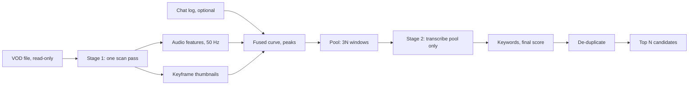

# Shorts handoff: design

Date: 2026-11-24, updated the same day after the fix pass. No Shorts code has been written and Phase 0 has not started. Line numbers refer to commit `f9b4e31` ("baseline before audit fixes"); later fixes moved some of them. `E/` = `engine/app/`, `R/` = `apps/desktop/src/renderer/src/`.

## 0. Read this first

1. **The fix pass is done.** See `FIX_REPORT.md`. Every High and Medium audit finding is fixed except F-22, which is partly fixed.
2. **The frame-accurate cut path of section 3 is already in the app** (findings N-01 to N-03), in `E/media/render.py` and `E/media/probe.py`, and used by every export. The Shorts cut only adds landscape scaling and a bitrate.
3. **Transcription does not need the GPU.** On this PC the CPU is fast enough for candidate-only transcription, so the only GPU step is H.264 encoding.
4. **Your answers are in section 13.** Languages were left as a choice in the answer, so this plans for the harder case, mixed Bangla and English. Section 5 says plainly what to expect.

---

## 1. Current capabilities and gaps

### What exists and can be reused

| Capability | Where | Reuse |
|---|---|---|
| Import a local file in place, read-only | `E/api/sources.py:33-40`, `E/ingest.py:160-247` | Yes, with a lighter VOD path |
| Probe, rotation, frame rate | `E/media/probe.py` | Yes, after N-02 |
| FFmpeg runner with progress and cancel | `E/media/transcode.py:16-66` | Yes, after F-15 |
| Encoder choice and GPU→CPU fallback | `E/media/render.py:49-71`, `E/exports.py:356-365` | Yes |
| Word-level speech-to-text | `E/analysis/transcribe.py` | Yes, extended |
| SRT writer, cue grouping | `E/captions/cues.py:38-127` | Yes |
| Face detector (YuNet) | `E/reframe/detect.py:48-72` | Yes |
| Smooth, shot-aware crop paths | `E/reframe/track.py:127-170` | Yes, fed with motion instead of faces |
| Edge snapping, overlap-free selection | `E/analysis/candidates.py:132-174`, `E/analysis/scoring.py:128-140` | Pattern |
| Background-job pattern, events | `E/exports.py:164-246`, `E/events.py` | Pattern |
| Player, timeline, rectangle overlay | `R/components/editor/Stage.tsx`, `Timeline.tsx`, `CropOverlay.tsx` | Adapted |
| Agent CLI | `scripts/clip.mjs` | New commands |

### What is missing

| Need | Today |
|---|---|
| Long VODs | Import always transcodes a full 480p proxy (`E/ingest.py:222-231`): 14× real time, about 17 min for 4 h. Whole audio is held in memory (F-22) |
| Gameplay moment detection | "Action" mode uses loudness and scene cuts on fixed windows. No shouting, laughter or chat; keywords need a full transcript (`E/analysis/manager.py:166-171`) |
| Editable keyword list | Only a one-off field in a dialog |
| Landscape rough cut at a bitrate | Exports target five sizes with quality presets only (`E/media/render.py:17-28`); no bitrate |
| Pre- and post-roll | Fixed 150/300 ms (`E/analysis/candidates.py:13-14`) |
| Facecam presets or detection | None |
| Motion-based region | None; smart framing follows faces only |
| Word confidence | faster-whisper provides `probability`; it is discarded at `E/analysis/transcribe.py:105-108` |
| Candidate-only transcription | Always the whole file |
| Thumbnails, package, review screen | None |
| Fully offline operation | Not guaranteed, see below |
| Everything in the project folder | Not by default, see below |

### Offline and folder rules: where today's code breaks them

| Issue | Location | Design |
|---|---|---|
| Model loading contacts Hugging Face | `E/analysis/transcribe.py:49-54` | Pass a local folder and `local_files_only=True`, set `HF_HUB_OFFLINE=1`. Missing model = clear message |
| Update checks | `apps/desktop/src/main/updater.ts:53-57` | Off when `CLIP_OFFLINE=1` |
| Link import | `E/media/download.py`, `R/components/ImportPanel.tsx` | Hidden and rejected when offline |
| Data in `%APPDATA%` | `apps/desktop/src/main/engine.ts:112`, `main/index.ts:9` | Default to `<project>/.data` |
| Temp files in `%TEMP%` | `E/exports.py:313` | `<data>/work/<job>/` |
| Exports default to Videos | `main/index.ts:83-86` | `<project>/output/` |

Models are fetched once at setup, or copied by hand into `.data/models`. After that nothing needs a network.

**Protecting originals.** Sources are only ever `-i` inputs. One helper, `assert_not_source(path)`, refuses to write to any registered source path (compared after resolving links) and is called before every FFmpeg run and file write in the new package.

---

## 2. Moment detection

### 2.1 Two stages



Stage 1 is cheap and covers everything. Stage 2 runs speech-to-text only on the pool, so keywords can promote or demote pool members.

**Known limit.** A calm moment marked only by a keyword is missed if nothing else reacted. A **Thorough** option transcribes all detected speech with the `base` model first; on this CPU that adds roughly 10 minutes for 4 h.

### 2.2 The scan pass

One FFmpeg process, two outputs, nothing stored at full size:

- **Audio**: 16 kHz mono PCM on a pipe, processed in 60 s blocks, so memory stays flat. Track choice: see 2.3.1.
- **Keyframes**: 320×180 frames using the input option `-discard nokey`. Measured 235×, against 52× for `-skip_frame nokey` and 33× for a full decode. GPU decoding was slower (5×), so it isn't used.

Keyframes are typically every 2 s on Twitch, up to about 5 s on YouTube. That is enough for a weak scene signal; exact cut times are found later by fully decoding just the candidates.

Results go to `.data/projects/<p>/sources/<s>/shorts/scan-v1.npz` (about 11 MB for 4 h), written atomically, with failures raised and never cached (F-18).

### 2.3 Signals

Each becomes a 0..1 curve at 10 Hz. Baselines are local (rolling median and MAD over 120 s), so a loud game section doesn't hide or fake moments.

| Signal | Method | Trust |
|---|---|---|
| `loudness_spike` | `z` = deviation of 100 ms RMS from baseline; `clip((z−2)/4, 0, 1)`, at least 0.3 s | High |
| `shout` | Voice-band (300–3400 Hz) deviation against *speech-only* baseline × speech probability × spectral-tilt factor (2–4 kHz vs 0.3–1 kHz; vocal effort lifts highs) | Medium; separates voice from explosions |
| `laughter` | Share of voice-band envelope energy modulated at 3.5–6.5 Hz over 2 s, gated by speech probability | Low-medium. A heuristic, so low weight |
| `scene_change` | Color-histogram distance between keyframes, scored as rate over 20 s against baseline | Low; weak support |
| `keyword` | Stage 2 match, below | High |
| `chat_spike` | Optional, below | High |

Speech probability comes from the voice-activity model already shipped inside faster-whisper (CPU, 866×); you confirmed it is allowed.

Penalties: static picture (BRB, loading), black frames, and a window with no speech and no chat.

#### 2.3.1 Which sound is listened to

| Recording | `shout`, `laughter`, speech, transcript | `loudness_spike` |
|---|---|---|
| Separate microphone track found | Microphone | Mixed track, so big game moments still count |
| One mixed track (all downloaded VODs) | Mixed | Mixed |

- **Finding it.** The scan reads every audio stream's title. A stream called "mic", "microphone", "voice" or similar is suggested. Without useful titles, streams are compared on a 60 s sample: a microphone has long silences, most of its energy in the voice band, and is contained in the mix. The user confirms once, and the choice is remembered with the stream layout.
- **Fallback.** With one track, or with an unconfirmed guess, the mixed sound is used. Nothing else changes, and a missing microphone is never an error.
- **Weights.** With a microphone, `shout` and `laughter` are far more trustworthy, so their weights rise to 0.35 and 0.20, with `loudness_spike` at 0.20, `keyword` 0.15 and `scene_change` 0.10.
- **Output is unaffected.** `clip.mp4` always carries the mixed track. `meta.json` records which one was listened to (`detection.audio_source`).
- **Cost.** One more PCM output of the same scan; no extra read of the file.

### 2.4 Keyword list

`.data/shorts/keywords.json`, editable in the app or a text editor:

```json
{
  "version": 1,
  "groups": [
    {"name": "hype",   "weight": 1.0, "words": ["let's go", "no way", "oh my god", "clutch"]},
    {"name": "clip it", "weight": 1.5, "words": ["clip that", "clip it"]},
    {"name": "funny",  "weight": 0.8, "words": ["what was that", "I'm crying"]}
  ]
}
```

Matching: Unicode NFC, case-folded, compared as token sequences with punctuation removed, with `(?<!\w)…(?!\w)` boundaries. This avoids the `\b` bug (F-37), so symbols and non-English words work. Strength = group weight × mean word confidence, capped at 1.

### 2.5 Chat log (optional)

You don't use a chat log tool (your answer left the template line in, read that way), so this is the lowest priority in the plan and nothing depends on it. Without a log there is no chat signal, no setting to fill in and no warning.

Importers normalize to `(t_seconds, user, text)`:

| Format | Detection |
|---|---|
| TwitchDownloader JSON | `comments[].content_offset_seconds`, `commenter.name`, `message.body` |
| Text | `[h:mm:ss] user: message` |
| CSV | header with a time, user and message column |

Spike = messages and *unique chatters* per 5 s against a 5 min baseline, with extra weight for reaction tokens (editable: `LUL`, `KEKW`, `POG`, `W`, `clip`). It is shifted earlier by a reaction delay (default 6 s) plus a user offset for logs that don't start with the video. Files are size-limited, parsed as data only, and never sent anywhere.

Without a log the signal doesn't exist and its weight is shared out, the same way `E/analysis/scoring.py:100-107` redistributes the keyword weight.

### 2.6 Scoring

Recommended: transparent weighted fusion with per-VOD normalization. No training data is needed, and every score can be explained.

| | loudness | shout | laughter | keyword | scene | chat |
|---|---|---|---|---|---|---|
| Weight, no chat | 0.25 | 0.30 | 0.15 | 0.20 | 0.10 | n/a |
| Weight, with chat | 0.19 | 0.22 | 0.11 | 0.15 | 0.08 | 0.25 |

1. `F(t) = Σ wᵢ·sᵢ(t)`, smoothed (Gaussian, σ 1.5 s).
2. Peaks at least 20 s apart. The **core** is where `F` exceeds 35% of its peak, bridging 3 s gaps, limited to 4–35 s.
3. `score = 100 · clip(0.55·P + 0.25·M + 0.20·C − penalties, 0, 1)`
   - `P`: the peak's percentile among all peaks in this VOD, scaled by its absolute strength
   - `M`: mean of `F` over the core
   - `C`: distinct signal types above 0.5, divided by 3, at most 1. Agreement between independent signals is the best evidence of a real moment
4. Weights live in `.data/shorts/settings.json`.

Scores rank moments *within* one VOD. They are not comparable between VODs.

### 2.7 Count and de-duplication

Settings: `candidates_per_vod` (default 20, 1–100), `min_score` (default 35; may return fewer), `pool_factor` (default 3), `max_per_15_min` (default 4).

1. **Time**: merge cores whose peaks are under 20 s apart if the union is ≤ 35 s, otherwise keep the better. Then drop any candidate whose padded window overlaps a better one by over 30%.
2. **Content** (replays, rerun segments, repeated jingles): two candidates are duplicates if at least two of three hold: loudness-envelope correlation > 0.9, median keyframe difference-hash distance ≤ 8 of 64, transcript token Jaccard > 0.7. Keep the better and record the other under `duplicates`.
3. **Spread**: apply `max_per_15_min` greedily by score.

This also avoids F-35, where near-copies fill the alternates pool.

### Modules

| New | Purpose |
|---|---|
| `E/shorts/scan.py` | Scan pass, streaming features |
| `E/shorts/signals.py` | Signal curves |
| `E/shorts/keywords.py`, `chat.py` | Lists, matching, importers |
| `E/shorts/detect.py` | Fusion, peaks, scoring |
| `E/shorts/dedupe.py` | The three rules |

Touched: `E/ingest.py` (a `vod` import that probes and scans without a full proxy), `E/sources.py`, `E/db.py`.

---

## 3. Rough cuts

Cut = `[core_start − pad_before, core_end + pad_after]`, defaults 15 s and 10 s, clamped to the VOD. Edges snap **outward only**, by up to 1.5 s, to a silence or word gap, so the requested padding is never reduced. Actual padding goes in `meta.json`.

### Frame-accurate graph

**Implemented in the fix pass** (`seek_point`, `grid_filters`, `clip_frames` in `E/media/render.py`; `grid_rate`, `preroll_for` in `E/media/probe.py`). `E/shorts/cut.py` calls these; it must not have its own version.

```
ffmpeg -ss <start − P> -i SRC
  [0:v] setpts=PTS−P/TB, fps=<R>:start_time=0, scale=…, format=yuv420p [v]
  [0:a] asetpts=PTS−P/TB, aresample=async=1:first_pts=0 [a]
  -frames:v <N> -t <N/R> …
```

- **Pre-roll `P`** is 1 s for formats with an index (MP4, MKV, WebM). For others (`.ts`) the keyframe before the cut is looked up and reading starts half a second before it (N-03).
- **Constant frame grid, always.** The VFR flag isn't trusted (N-02). Frames sit in the middle of grid cells, so timestamp rounding can't move them.
- **Audio** is resampled against the same clock, filling gaps and late starts.
- **Rate `R`**: the source's exact rate if it is within 0.05% of 23.976, 24, 25, 29.97, 30, 50, 59.94 or 60; otherwise (variable rate only) its full speed if it mostly runs at that, or the nearest of 30 and 60. Unusual constant rates are kept. Integer frame counts define the length.
- **Phase**: where the video's frames sit relative to the file's start is measured and taken out, so frames stay centred even when sound starts earlier.

Measured with this graph:

| Test | Today's `render_clip` | Proposed |
|---|---|---|
| Wrong frames of 300, MKV/WebM 60 fps | 100–299 | 0 |
| Wrong frames of 300, MP4 60 fps | 299 (one frame late) | 0 |
| A/V offset, constant rate (30 events) | 9.0 ms mean and worst | 0.7 ms |
| A/V offset, variable-rate MKV (30 events) | −7.2 ms | 0.5 ms |

Tests now cover MP4, MKV, WebM and `.ts` at 30, 29.97, 59.94 and 60 fps (zero repeated, dropped or neighbouring frames), variable rate, and picture-to-sound offset under one frame, including `.ts`.

### Encoding

| Setting | Value |
|---|---|
| Picture | Fit inside 1920×1080, aspect kept, no crop, no bars. 16:9 is exactly 1080p; 720p is upscaled |
| Video | H.264 High, `yuv420p`, 2 s GOP, configurable bitrate (default 6 Mbps, maxrate 8, bufsize 12) |
| Encoder | `h264_nvenc -preset p5 -rc vbr`, else `libx264 -preset medium` |
| Audio | AAC 192 kb/s stereo 48 kHz, first or chosen track, no loudness changes |
| HDR | Tone-mapped by `E/media/color.py` (done in F-25); stills in section 6 use the same filter |

A 6.0 Mbps NVENC test produced 6.3 Mbps overall. Bitrate arguments are added beside `_QUALITY_ARGS` in `E/media/render.py:17-46`; the fallback pattern is `E/exports.py:356-365`.

---

## 4. Facecam handling

### 4.1 Presets

```sql
CREATE TABLE layouts (
  id INTEGER PRIMARY KEY AUTOINCREMENT,
  name TEXT NOT NULL UNIQUE,
  kind TEXT NOT NULL CHECK (kind IN ('facecam','none')),
  x REAL, y REAL, w REAL, h REAL,           -- 0..1 of the source frame; NULL when kind = 'none'
  created_at TEXT NOT NULL
);
```

Normalized like crops today (`E/aspects.py:1-5`), so one preset works at 720p and 1080p. "No facecam" is a built-in row that can't be deleted. Both cases go through the same code path and package format.

Assignment: each VOD has a layout, each candidate may override it. A VOD may also change layout mid-stream, so `layout_spans` can list `[start, end, layout_id]`. A candidate takes the layout at its peak and is flagged if it crosses a change.

Drawing: adapt `R/components/editor/CropOverlay.tsx`, which locks the aspect ratio; it needs a free-aspect option. Shown over a sample frame, with a slider to check other times.

### 4.2 Auto-detect

A suggestion only; it never applies itself. Runs on CPU, about 10 s per VOD.

1. Sample ~240 frames evenly, at 1280×720. The detector takes 15.5 ms per frame; small webcam faces need that size.
2. Detect faces and cluster their centers.
3. Keep a cluster if it is present in ≥ 40% of samples, its spread is < 3% of the frame, and it lies in the outer 40% of the width.
4. Reject static pictures: the region must change over time (a HUD portrait doesn't), and must not be the whole picture ("Just Chatting").
5. Find the rectangle. Average the edge strength over all samples: webcam borders stay, gameplay edges cancel. Choose the rectangle around the cluster with the strongest persistent edges on its four sides.
6. No clear border (cut-out or green-screen camera)? Expand the typical face box to 3.0× width and 2.6× height and mark it approximate.
7. Report `present`, the rectangle and a confidence. Below 0.5, suggest "No facecam" but show the best guess.

If an existing preset overlaps by ≥ 70%, suggest that preset.

### 4.3 Action region (no facecam)

Per candidate, only when the layout is "none":

1. Decode the candidate at 5 fps, 320×180 (33×; about 2 s per clip).
2. Dense optical flow (OpenCV DIS, 1.2 ms per pair). Subtract the median flow, so camera turns don't count as action.
3. Mask the HUD: pixels that barely change across the clip.
4. Weight by a mild center bias, find the strongest blob, record center, size and strength.
5. Build a smooth 9:16 path with `camera_path` (`E/reframe/track.py:127`), passing the region as the "subject". It already handles scene cuts, stillness and speed limits. It needs one parameter so `HEADROOM` (line 18) can be 0.
6. Low strength: hold the center and record a low confidence.

Global motion and HUD removal are what make this usable for shooters; particle-heavy games will be noisier.

### Modules

`E/shorts/layouts.py`, `E/shorts/facecam.py`, `E/shorts/action.py`, `E/api/layouts.py`, `R/components/shorts/LayoutEditor.tsx`.

---

## 5. Transcription

| Point | Design |
|---|---|
| What | Pool windows (stage 2), then final candidates. Final windows are cut ±30 s wider, so later trims need no new run |
| Audio | Decoded per window with `-ss/-t`, never the whole file (avoids F-22) |
| Model | Loaded once per batch; today every call reloads it (`E/analysis/transcribe.py:89`) |
| Choice | `base` for the pool, `small` for final candidates; both configurable |
| Device | CPU `int8` by default. GPU only if a warm-up inference succeeds (done in F-01; on this PC it doesn't, because cuBLAS is missing) |
| Confidence | `Word.probability`, rounded to 3 decimals |
| Times | `word.start − clip_start`. A word belongs to the clip if its middle is inside; edges are clamped |
| Language | Set per VOD (English, Bangla, or mixed), see 5.1. The English filler prompt is used only for English or auto-detect (done in F-13) |
| Hallucinations | VAD on, no conditioning on previous text, `hallucination_silence_threshold=2`; segments with high `no_speech_prob` and low `avg_logprob` are dropped |
| SRT | `make_cues` + `to_srt` with the `classic` limits (`E/captions/cues.py`, `styles.py:44`) |

Results are cached by absolute source time, so overlapping windows share work. Existing transcripts aren't touched: the new data lives beside the candidate, and `TRANSCRIPT_VERSION` stays 2 so nobody's project is retranscribed.

### 5.1 Languages: what to expect

**English** is the strong case: `small` is usable for keywords and captions on clear speech, less so under loud game sound.

**Bangla and mixed Bangla-English: expect poor results from the models the app has (`tiny`, `base`, `small`).** I could not measure this here, because Windows has no Bangla test voice and no recording of yours was used. These are known properties of the model family, to be confirmed on your clips:

- Bangla was a small part of the training data, and these sizes make errors in most Bangla words. Treat Bangla text from them as unreliable, for keywords and as a transcript to edit from.
- The model assumes one language per 30 s window. Switching mid-sentence makes it translate, transliterate or drop the other language, often with confident-looking output.
- Romanized Bangla in your keyword list ("ki holo", "bhai") will not match: the output is Bangla script or misheard English.
- Word times and confidence are also less reliable when the language is wrong.

What the design does about it:

| Setting | Behavior |
|---|---|
| English | As above |
| Mixed | Each speech segment's language is detected (`multilingual=True` in faster-whisper, checked to exist). Keywords match only in segments detected as English, and only with mean confidence ≥ 0.6. Keyword weight drops from 0.20 to 0.10; `shout` and `laughter`, which need no words, take the rest |
| Bangla | Keywords off by default; transcript still exported, with its confidence |

- Keyword groups can carry a language and several spellings (`"words": ["কি হলো", "ki holo"]`).
- `words.json` gets a per-word `language`, and `meta.json` a `transcript.reliable` flag (false for Bangla, or mean confidence < 0.5), so your editing step knows when to re-listen.
- **Moment detection itself does not depend on language.** Loudness, shouting, laughter and scene changes work the same in any.

Better Bangla needs a bigger or Bangla-tuned speech model, still local and still speech-to-text. `large-v3` is slow on the CPU and would want CUDA 12's cuBLAS inside the project folder. A Bangla fine-tune converted for CTranslate2 is the other route. Neither is downloaded or assumed; see decision 3. **Phase 2 starts with a measurement on 10 of your own short clips**, before any keyword work for Bangla.

Game audio lowers accuracy. Confidence is exported so the editing step can filter, and choosing a microphone track helps most.

Modules: `E/shorts/transcript.py`; `E/analysis/transcribe.py` gains `load_model()` and `transcribe_window()`.

---

## 6. Thumbnails

### Picking frames

1. Sample at 4 fps from 2 s before the core to 2 s after it, from the original.
2. Drop frames within 150 ms of a scene cut, and black, white or faded frames.
3. Score:

| Part | Measure | Weight, facecam | Weight, none |
|---|---|---|---|
| Sharpness | Laplacian variance at 960 px, as a percentile within the clip. With a facecam: 60% gameplay, 40% facecam | 0.40 | 0.60 |
| Peak closeness | `exp(−abs(t − peak)/3)` | 0.30 | 0.40 |
| Face | In the facecam region, upscaled: size, detector score, frontality from eye/nose symmetry | 0.30 | n/a |

4. Pick greedily: at least 0.75 s apart and difference-hash distance > 10. Take 3–5 (default 4). If the clip is too uniform, return fewer and note it.

### Export

- **Stills**: source resolution, extracted at the exact source frame using the section 3 grid.
- **`thumbnail_vertical.jpg`** (1080×1920, from the top or user-chosen frame):
  - *Facecam*: facecam on top, full width, 35% of the height (cover-cropped around the face), gameplay below, cropped around that frame's motion center and never covering the facecam twice.
  - *No facecam*: 1080×1350 crop around the action region, centered on a blurred, darkened full-frame background.
  - No text.
- **Size**: JPEG quality starts at 95 and is searched downward until under 2,000,000 bytes. If quality 60 still isn't enough (8K, heavy noise), the still is downscaled and that is recorded. A noise-like 1080p frame was 1.0 MB at quality 92, so this should be rare.

Composition uses OpenCV and NumPy, both already installed. Module: `E/shorts/thumbs.py`.

---

## 7. Handoff package

```
output/<vod name>/
  01_00h42m10s_score87/
    clip.mp4
    transcript.srt
    words.json
    meta.json
    thumbs/
      thumb_01.jpg … thumb_04.jpg
      thumbnail_vertical.jpg
```

Names use `safe_filename` (`E/exports.py:126`). A package is built in `.data/work/<uuid>/`, validated, then moved into place, so a half-written package never appears. Existing folders get ` (2)`; nothing is overwritten. Re-export after an edit creates a new folder unless the user chooses to replace it.

**Conventions.** Times are seconds with 3 decimals. `t`, `start` and `end` are relative to the first frame of `clip.mp4` unless named `source_*`. Rectangles are integer pixels in `clip.mp4`; `*_normalized` is 0..1. Both files are produced from Pydantic models in `E/shorts/schema.py`, so code and schema can't drift.

### `words.json`

```json
{
  "$schema": "https://json-schema.org/draft/2020-12/schema",
  "title": "words.json",
  "type": "object",
  "additionalProperties": false,
  "required": ["schema_version", "language", "model", "clip_duration", "words"],
  "properties": {
    "schema_version": {"const": 1},
    "language": {"type": ["string", "null"], "description": "ISO 639-1; null when there is no speech"},
    "model": {"type": ["string", "null"]},
    "clip_duration": {"type": "number", "exclusiveMinimum": 0},
    "words": {
      "type": "array",
      "items": {
        "type": "object",
        "additionalProperties": false,
        "required": ["index", "text", "start", "end", "confidence", "language"],
        "properties": {
          "index": {"type": "integer", "minimum": 0},
          "language": {"type": ["string", "null"], "description": "Detected for the segment the word is in"},
          "text": {"type": "string", "minLength": 1},
          "start": {"type": "number", "minimum": 0},
          "end": {"type": "number", "minimum": 0},
          "confidence": {"type": "number", "minimum": 0, "maximum": 1}
        }
      }
    }
  }
}
```

Rules JSON Schema can't express: `end >= start`, `end <= clip_duration`, sorted by `start`. Silent clips have an empty list and an empty SRT.

### `meta.json`

```json
{
  "$schema": "https://json-schema.org/draft/2020-12/schema",
  "title": "meta.json",
  "type": "object",
  "additionalProperties": false,
  "required": ["schema_version", "created_at", "tool_version", "source", "clip", "detection",
               "facecam", "action_region", "thumbnails", "transcript"],
  "properties": {
    "schema_version": {"const": 1},
    "created_at": {"type": "string", "format": "date-time"},
    "tool_version": {"type": "string"},
    "source": {
      "type": "object",
      "additionalProperties": false,
      "required": ["file_name", "source_start", "source_end", "duration", "width", "height", "fps"],
      "properties": {
        "file_name": {"type": "string", "description": "Name only, no path"},
        "source_start": {"type": "number", "minimum": 0},
        "source_end": {"type": "number", "exclusiveMinimum": 0},
        "duration": {"type": "number", "exclusiveMinimum": 0},
        "width": {"type": "integer"},
        "height": {"type": "integer"},
        "fps": {"type": "string", "pattern": "^[0-9]+/[0-9]+$"}
      }
    },
    "clip": {
      "type": "object",
      "additionalProperties": false,
      "required": ["file", "duration", "frames", "width", "height", "fps", "fps_exact", "video_codec",
                   "audio_codec", "has_audio", "bitrate_kbps", "core_start", "core_end", "peak",
                   "pad_before", "pad_after", "edited_by_user"],
      "properties": {
        "file": {"const": "clip.mp4"},
        "duration": {"type": "number", "exclusiveMinimum": 0},
        "frames": {"type": "integer", "minimum": 1},
        "width": {"type": "integer"},
        "height": {"type": "integer"},
        "fps": {"type": "number"},
        "fps_exact": {"type": "string", "pattern": "^[0-9]+/[0-9]+$"},
        "video_codec": {"const": "h264"},
        "audio_codec": {"type": ["string", "null"], "enum": ["aac", null]},
        "has_audio": {"type": "boolean"},
        "bitrate_kbps": {"type": "integer", "description": "Target video bitrate"},
        "core_start": {"type": "number"},
        "core_end": {"type": "number"},
        "peak": {"type": "number"},
        "pad_before": {"type": "number", "description": "Actual; may differ from the setting"},
        "pad_after": {"type": "number"},
        "edited_by_user": {"type": "boolean"}
      }
    },
    "detection": {
      "type": "object",
      "additionalProperties": false,
      "required": ["rank", "score", "weights", "chat_used", "audio_source", "signals", "duplicates"],
      "properties": {
        "rank": {"type": "integer", "minimum": 1},
        "score": {"type": "number", "minimum": 0, "maximum": 100},
        "weights": {"type": "object", "additionalProperties": {"type": "number"}},
        "chat_used": {"type": "boolean"},
        "audio_source": {"enum": ["microphone", "mixed"]},
        "signals": {
          "type": "array",
          "items": {
            "type": "object",
            "additionalProperties": false,
            "required": ["type", "start", "end", "peak", "strength"],
            "properties": {
              "type": {"enum": ["loudness_spike", "shout", "laughter", "keyword", "scene_change", "chat_spike"]},
              "start": {"type": "number"},
              "end": {"type": "number"},
              "peak": {"type": "number"},
              "strength": {"type": "number", "minimum": 0, "maximum": 1},
              "detail": {
                "type": "object",
                "description": "keyword: text, group. chat_spike: messages, chatters. others: value, baseline"
              }
            }
          }
        },
        "duplicates": {
          "type": "array",
          "items": {
            "type": "object",
            "additionalProperties": false,
            "required": ["source_start", "source_end", "score"],
            "properties": {
              "source_start": {"type": "number"},
              "source_end": {"type": "number"},
              "score": {"type": "number"}
            }
          }
        }
      }
    },
    "facecam": {
      "oneOf": [
        {"type": "null"},
        {
          "type": "object",
          "additionalProperties": false,
          "required": ["x", "y", "width", "height", "normalized", "preset", "origin", "crosses_layout_change"],
          "properties": {
            "x": {"type": "integer", "minimum": 0},
            "y": {"type": "integer", "minimum": 0},
            "width": {"type": "integer", "minimum": 1},
            "height": {"type": "integer", "minimum": 1},
            "normalized": {"$ref": "#/$defs/rect"},
            "preset": {"type": ["string", "null"]},
            "origin": {"enum": ["preset", "manual", "auto_confirmed"]},
            "crosses_layout_change": {"type": "boolean"}
          }
        }
      ]
    },
    "action_region": {
      "oneOf": [
        {"type": "null"},
        {
          "type": "object",
          "additionalProperties": false,
          "required": ["sample_fps", "confidence", "samples", "crop_9x16"],
          "properties": {
            "sample_fps": {"type": "number"},
            "confidence": {"type": "number", "minimum": 0, "maximum": 1},
            "samples": {
              "type": "array",
              "description": "Raw motion region, normalized",
              "items": {
                "type": "object",
                "additionalProperties": false,
                "required": ["t", "cx", "cy", "w", "h", "strength"],
                "properties": {
                  "t": {"type": "number"},
                  "cx": {"type": "number"}, "cy": {"type": "number"},
                  "w": {"type": "number"}, "h": {"type": "number"},
                  "strength": {"type": "number", "minimum": 0, "maximum": 1}
                }
              }
            },
            "crop_9x16": {
              "type": "array",
              "description": "Smoothed keyframes; interpolate linearly, fixed size",
              "items": {
                "type": "object",
                "additionalProperties": false,
                "required": ["t", "x", "y", "width", "height"],
                "properties": {
                  "t": {"type": "number"},
                  "x": {"type": "integer"}, "y": {"type": "integer"},
                  "width": {"type": "integer"}, "height": {"type": "integer"}
                }
              }
            }
          }
        }
      ]
    },
    "thumbnails": {
      "type": "object",
      "additionalProperties": false,
      "required": ["candidates", "vertical"],
      "properties": {
        "candidates": {
          "type": "array",
          "maxItems": 5,
          "items": {
            "type": "object",
            "additionalProperties": false,
            "required": ["file", "t", "source_t", "width", "height", "bytes", "score", "sharpness",
                         "peak_closeness", "face", "selected", "downscaled"],
            "properties": {
              "file": {"type": "string"},
              "t": {"type": "number"},
              "source_t": {"type": "number"},
              "width": {"type": "integer"},
              "height": {"type": "integer"},
              "bytes": {"type": "integer", "maximum": 1999999},
              "score": {"type": "number", "minimum": 0, "maximum": 1},
              "sharpness": {"type": "number", "minimum": 0, "maximum": 1},
              "peak_closeness": {"type": "number", "minimum": 0, "maximum": 1},
              "face": {
                "oneOf": [
                  {"type": "null"},
                  {
                    "type": "object",
                    "additionalProperties": false,
                    "required": ["visible", "size", "detector_score", "frontality"],
                    "properties": {
                      "visible": {"type": "boolean"},
                      "size": {"type": "number", "description": "Share of the facecam area"},
                      "detector_score": {"type": "number"},
                      "frontality": {"type": "number", "minimum": 0, "maximum": 1}
                    }
                  }
                ]
              },
              "selected": {"type": "boolean"},
              "downscaled": {"type": "boolean"}
            }
          }
        },
        "vertical": {
          "type": "object",
          "additionalProperties": false,
          "required": ["file", "from", "layout", "width", "height", "bytes"],
          "properties": {
            "file": {"const": "thumbs/thumbnail_vertical.jpg"},
            "from": {"type": "string"},
            "layout": {"enum": ["facecam_stack", "action_blur"]},
            "width": {"const": 1080},
            "height": {"const": 1920},
            "bytes": {"type": "integer", "maximum": 1999999}
          }
        }
      }
    },
    "transcript": {
      "type": "object",
      "additionalProperties": false,
      "required": ["srt", "words", "language", "model", "word_count", "mean_confidence", "reliable"],
      "properties": {
        "srt": {"const": "transcript.srt"},
        "words": {"const": "words.json"},
        "language": {"type": ["string", "null"]},
        "model": {"type": ["string", "null"]},
        "word_count": {"type": "integer", "minimum": 0},
        "mean_confidence": {"type": ["number", "null"]},
        "reliable": {"type": "boolean"}
      }
    }
  },
  "oneOf": [
    {"properties": {"facecam": {"type": "null"}, "action_region": {"type": "object"}}},
    {"properties": {"facecam": {"type": "object"}, "action_region": {"type": "null"}}}
  ],
  "$defs": {
    "rect": {
      "type": "object",
      "additionalProperties": false,
      "required": ["x", "y", "w", "h"],
      "properties": {
        "x": {"type": "number", "minimum": 0, "maximum": 1},
        "y": {"type": "number", "minimum": 0, "maximum": 1},
        "w": {"type": "number", "exclusiveMinimum": 0, "maximum": 1},
        "h": {"type": "number", "exclusiveMinimum": 0, "maximum": 1}
      }
    }
  }
}
```

The final `oneOf` states the rule that exactly one of facecam and action region is present.

---

## 8. Review screen

```
┌ Candidates (20) ─────────┬ Preview ────────────────────────────┐
│ ☑ 1  87  00:42:10  45 s  │  [player, facecam box overlay]      │
│ ☑ 2  81  02:13:55  52 s  │  ├─── pad ──┤ core ├─ pad ─┤        │
│ ☐ 3  77  01:05:20  38 s  │  signal lanes: loud shout kw chat   │
│ …        [Delete]        │  In / Out / nudge / undo            │
├──────────────────────────┼ Thumbnails ─────────────────────────┤
│ Layout: Main cam (auto ✓)│ [1★][2][3][4] [+ use current frame] │
│ [Export 12 selected]     │ vertical preview                    │
└──────────────────────────┴─────────────────────────────────────┘
```

| Need | Design |
|---|---|
| Ranked list | Sort by score or time; signal icons; duplicates expandable |
| Preview | A 720p30 proxy of the candidate ±60 s, made in the background and cached (23× on the encoder) |
| Adjust start/end | `Timeline.tsx` limited to the preview range. Edits snap to the output grid; words, signals and thumbnails recompute from cached absolute times. Moving past the cached range queues more work |
| Thumbnails | Click to select, or use the current frame |
| Layout | Accept a suggestion, choose a preset, draw one, or "No facecam" |
| Delete | Soft delete with undo; never touches files |
| Export | Selected packages, one at a time, with progress and cancel |

**Frontend**: `R/components/shorts/{ShortsView,CandidateList,CandidatePlayer,SignalLanes,ThumbStrip,LayoutEditor,ScanDialog}.tsx`. `R/App.tsx` gains a screen, `SourceCard.tsx` a button, `lib/api.ts` types and methods, `store.ts` state and events. Frame-to-ms must use the exact rational rate, not `lib/time.ts` rounding (F-36).

**Data**:

```sql
CREATE TABLE shorts_runs (
  id INTEGER PRIMARY KEY AUTOINCREMENT,
  source_id INTEGER NOT NULL REFERENCES sources(id) ON DELETE CASCADE,
  status TEXT NOT NULL, stage TEXT, progress REAL NOT NULL DEFAULT 0,
  settings_json TEXT NOT NULL, error TEXT, created_at TEXT NOT NULL);
CREATE TABLE shorts_candidates (
  id INTEGER PRIMARY KEY AUTOINCREMENT,
  run_id INTEGER NOT NULL REFERENCES shorts_runs(id) ON DELETE CASCADE,
  start_ms INTEGER NOT NULL, end_ms INTEGER NOT NULL,
  core_start_ms INTEGER NOT NULL, core_end_ms INTEGER NOT NULL, peak_ms INTEGER NOT NULL,
  score REAL NOT NULL, signals_json TEXT NOT NULL, layout_id INTEGER REFERENCES layouts(id),
  thumb_json TEXT, state TEXT NOT NULL DEFAULT 'new', edited INTEGER NOT NULL DEFAULT 0,
  CHECK (end_ms > start_ms));
CREATE TABLE chat_logs (
  source_id INTEGER PRIMARY KEY REFERENCES sources(id) ON DELETE CASCADE,
  file_name TEXT NOT NULL, offset_ms INTEGER NOT NULL DEFAULT 0, summary_json TEXT NOT NULL);
```

**API** (`E/api/shorts.py`, `E/api/layouts.py`):

| Endpoint | Purpose |
|---|---|
| `POST /sources/{id}/shorts/scan`, `GET …/shorts`, `POST …/shorts/cancel` | Run and status |
| `PATCH /shorts/{cid}`, `DELETE /shorts/{cid}` | Trim, layout, delete |
| `POST /shorts/{cid}/thumb` | Select or add a frame |
| `GET /media/shorts/{cid}/{preview or thumb name}` | Media from fixed names |
| `POST /shorts/export` | Build packages |
| `GET/PUT /shorts/settings`, `GET/PUT /shorts/keywords` | Settings |
| `GET/POST/PATCH/DELETE /layouts`, `POST /sources/{id}/facecam/suggest` | Presets |
| `PUT/DELETE /sources/{id}/chat` | Chat log |

Events: `shorts_run`, `shorts_candidate`, `shorts_package`. CLI: `clip shorts scan|list|set|export`. `AGENTS.md` is updated in the same change, as it requires.

---

## 9. Performance

This PC: i5-14600K (14 cores, 20 threads), 16 GB RAM, RTX 5060 8 GB. Throughput below was measured on a synthetic 60 s, 1080p60, 6 Mbps clip, so startup time is included and real footage will vary. Whisper compute was timed with random weights of the right size. Nothing was run on a long VOD, following your safety rules.

| Step | Measured |
|---|---|
| Keyframe scan / audio decode | 235× / 695× |
| Speech probability / band energies | 866× / 4407× |
| Full decode to small frames, CPU / GPU | 33× / 5× |
| Whisper `base` / `small`, CPU int8 | 53× / 10× (before word alignment; planned at half) |
| NVENC p5 / x264 medium at 1080p60 | 5× / 2× |
| 720p preview, NVENC | 23× |
| Today's full proxy | 14× |

### Estimate: 4-hour VOD, 20 candidates of about 50 s, pool of 60

| Step | Device | Estimate |
|---|---|---|
| Scan pass (reads about 11 GB) | CPU, disk | 2–4 min |
| Detection, facecam suggestion | CPU | < 1 min |
| Pool transcription, `base`, ~60 min of audio | CPU | 2–3 min |
| Final transcription, `small`, ~35 min | CPU | 7–10 min |
| Action regions, thumbnails | CPU | 1–3 min |
| Preview proxies | GPU encoder | 2–3 min |
| **Ready to review** | | **about 15–25 min** |
| Export 20 clips | GPU encoder | 4–6 min (x264: 9–12) |

About half for 2 h. For 8 h, scanning doubles while the rest stays the same. Compare about 17 min today for the proxy alone. On a hard disk, reading may dominate the scan.

### Keeping the load reasonable

- **One GPU step at a time.** A process-wide `GpuLock` (`E/gpu.py`) around NVENC and any CUDA inference, including existing exports. Today `ExportManager` runs 2 workers (`E/exports.py:165`) beside the analysis worker.
- **GPU used only for encoding**, about 6–9 min in all; a "CPU only" setting exists.
- **If CUDA transcription is ever enabled**, `small` float16 should need roughly 1–2 GB; the model is unloaded before encoding.
- **CPU**: FFmpeg children start below normal priority, with a thread limit setting (default cores − 4). This affects only the app's own processes.
- **Memory**: streaming keeps the target under 1.5 GB. Work folders are removed after each job; a free-space check runs first.

---

## 10. Structure and jobs

`E/shorts/manager.py` follows the `ExportManager` pattern with **one** worker. Stages are checkpointed (scan, pool, transcripts, media), so a cancelled or crashed run resumes. Each job has a UUID work folder and writes state only while it owns its token, as F-04 requires. Existing features and tables keep working.

---

## 11. Prerequisites from the audit

| Item | State |
|---|---|
| N-01, N-02, N-03, F-02, F-12 (cutting and sync) | Done |
| F-01 (speech on the CPU when the GPU can't) | Done |
| F-04 (ids and folders per job) | Done. New tables must use `AUTOINCREMENT` and the same ownership check |
| F-14, F-15 (no orphaned FFmpeg) | Done |
| F-17 (safe migrations) | Done |
| F-18 (no cached failures) | Done. The scan must follow the same pattern |
| F-19, F-25 (live progress, HDR) | Done |
| F-22 (memory) | Partly: sound is read in pieces, but transcription still holds a whole file's audio. Shorts transcribes windows, so it isn't affected |
| F-35, F-36, F-37 | Low, not fixed. The Shorts code avoids them by design (2.4, 2.7, 8) |
| Offline mode, project-local folders | Not part of the fix pass; Phase 0 |

---

## 12. Phased plan

Sizes are one developer's focused days: S 1–2, M 3–5, L 6–10. Tests use generated or copied clips under 2 minutes; long-VOD behavior is tested with synthetic feature arrays.

| Phase | Content | Size |
|---|---|---|
| 0 | Foundations (most of it done by the fix pass) | M |
| 1 | **Smallest useful version**: scan, detect, cut, CLI package | L |
| 2 | Transcripts and keywords | M |
| 3 | Review screen | L |
| 4 | Facecam presets, action region, thumbnails | L |
| 5 | Auto-detect, content de-duplication, then chat logs (optional, last) | M |
| 6 | Tuning and hardening | M |

### Phase 0: Foundations
Offline mode and project-local folders. The fix pass covered the rest.
- [x] Numbered-frame tests: 0 wrong frames across MP4, MKV, WebM and TS at 30, 29.97, 59.94 and 60 fps (six start points each)
- [x] Flash-and-beep tests: drift under 1 frame for constant and variable rate
- [ ] With networking blocked, the engine starts, transcribes and exports
- [ ] A test run writes nothing outside the project folder
- [ ] Source SHA-256 and timestamp are unchanged after every operation
- [ ] All previously passing tests still pass

### Phase 1: Smallest useful version
- [ ] Microphone track: found in a two-track file, confirmed once, remembered; one-track files work unchanged
Audio and scene signals, scoring, time de-duplication, rough cuts, `clip.mp4` + `meta.json`, from the CLI.
- [ ] Synthetic file with 5 planted events: all 5 in the top 5, no overlaps
- [ ] Padding is 15 s and 10 s, clamped at file edges, recorded correctly
- [ ] `clip.mp4`: H.264/AAC, 1080p, video bitrate within 15% of target
- [ ] Candidate count and minimum score respected
- [ ] Peak memory under 1.5 GB on an 8 h synthetic feature stream
- [ ] Cancel stops within 2 s and leaves no files

### Phase 2: Transcripts and keywords
- [ ] First: word error measured on 10 short clips you provide (English, Bangla, mixed), reported to you before continuing
- [ ] Mixed mode: keywords match only in confident English segments
- [ ] `words.json` and `transcript.srt` validate; words lie within the clip
- [ ] Only pool windows are decoded (checked by call arguments)
- [ ] A keyword edit changes ranking without rescanning
- [ ] Missing CUDA falls back to CPU with a message
- [ ] Known speech sample: word starts within 250 ms of reference, 90% of words

### Phase 3: Review screen
- [ ] Rank, preview, trim, delete, undo, export selected
- [ ] The trimmed clip starts and ends on the frames shown
- [ ] Trimming within the cached range needs no new transcription
- [ ] Deleting or cancelling one job never changes another
- [ ] Usable by keyboard

### Phase 4: Layouts and thumbnails
- [ ] A drawn preset is reusable and correct at 720p and 1080p
- [ ] "No facecam" and facecam both produce complete, valid packages
- [ ] Exactly one of `facecam` and `action_region` is non-null
- [ ] Moving-target test: action crop contains the target ≥ 90% of the time, also during a simulated camera pan with a static HUD
- [ ] 3–5 stills, no near-duplicates, blurred frames never chosen over sharp ones
- [ ] All JPGs under 2 MB; vertical is exactly 1080×1920 in both layouts

### Phase 5: Optional inputs and suggestions
- [ ] Three chat formats parse; malformed files give a clear error
- [ ] Without chat, results match Phase 2 exactly
- [ ] Facecam suggestion: overlap ≥ 0.8 on bordered test layouts; no false positive on a static portrait or a moving game face
- [ ] Repeated segments collapse to one

### Phase 6: Tuning
- [ ] You rate one real VOD: at least 60% of the top 20 are usable. If not, adjust weights
- [ ] A 4 h VOD, run only when you say so, is ready to review within 30 min
- [ ] GPU steps never overlap (checked by log)
- [ ] A run interrupted at each stage resumes

Total: roughly 30–50 focused days (Phase 0 shrank). Phases 0–2 already give usable packages without a UI.

### Risks

| Risk | Mitigation |
|---|---|
| Loud games hide or fake reactions | Local baselines, speech gating, microphone track option |
| Laughter heuristic is weak | Low weight without a microphone track, switchable |
| Bangla or mixed speech is badly transcribed | Detection doesn't need words; keywords limited to confident English; `reliable` flag; measured before Phase 2 goes on |
| Quiet but good moments missed | Keywords, chat, Thorough mode, manual add |
| Borderless facecams | Approximate rectangle, confirmation always required |
| Chaotic action regions | Confidence recorded, centered fallback |
| Real performance differs | Phase 6 measurement; estimates are ranges |

---

## 13. Decisions

| # | Question | Answer |
|---|---|---|
| 1 | Voice-activity model inside the speech-to-text package | **Allowed** |
| 2 | Chat logs | **Optional; everything works without one.** The answer's "[I don't use any / I use ___]" was not filled in; read as "none" |
| 3 | Languages | **Open.** The answer's "[English only / mixed Bangla and English]" was not filled in, so mixed is planned. If it's English only, section 5.1's mixed mode can be dropped. If Bangla matters, decide whether a larger or Bangla-tuned speech model may be added to the project folder |
| 4 | Microphone track | **Both supported** (2.3.1): used when there is one, else the mixed sound. "[have / don't have]" was not filled in, but doesn't matter |
| 5 | Order | **Audit fixes first**: done. Phase 0 has not started |
